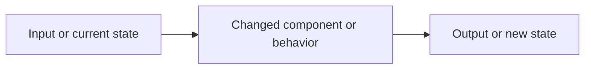

## Summary

[State what changed and why in two or three sentences. Link the spec and, when applicable, the issue and investigation.]

## Design

[Explain the selected design in one short paragraph. Use the diagram to show the changed components, behavior, or data flow rather than the whole project architecture.]

## Example

[Give one concrete before/after, input/output, or Given/When/Then example showing how the change behaves.]

## Evidence

- **Tests**: [List the checks performed and their outcomes.]
- **Full validation**: [Give the run ID of the latest full-validation run for this implementation, or write "not applicable".]
- **Run directory**: [Store the path or URI returned as `artifacts_location`, or write "not applicable".]

[Summarize the evidence needed to understand this PR; do not reproduce the complete validation result.]
