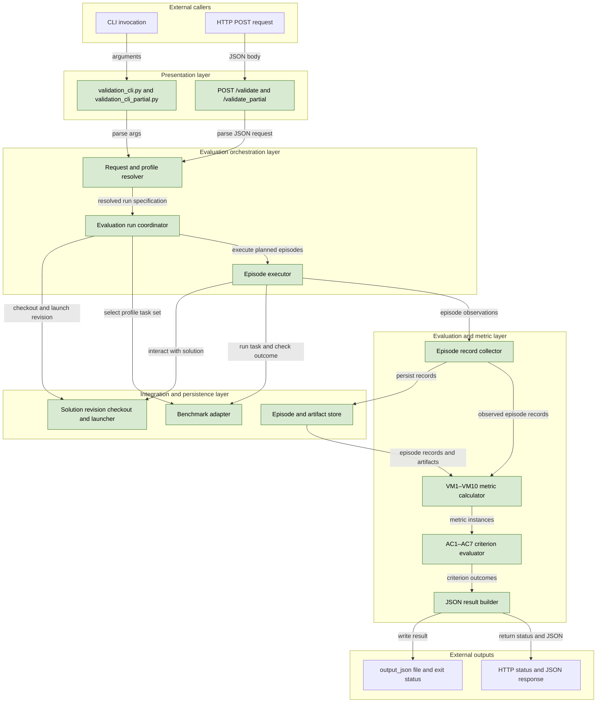
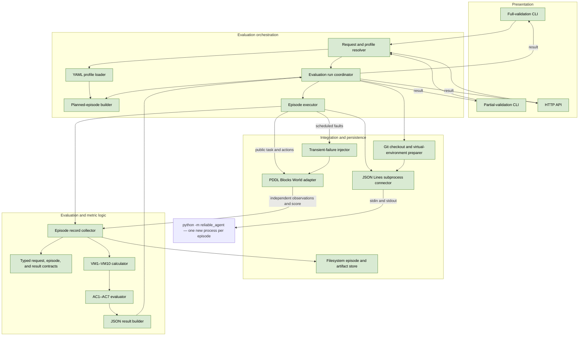

## Initial validation service

### 1. Executive summary

#### 1.1 Spec description

The implementation will provide the first working validation service for the `default` profile of `reliable-agent`. It will clone the requested solution repository at an exact commit into a temporary directory, create an isolated virtual environment, and run full or partial Blocks World evaluations through a minimal solution interface. It will compute VM1–VM10, evaluate AC1–AC7, retain auditable episode records, and return the common JSON result through the CLI and HTTP interfaces. It will distinguish solution failures from validation infrastructure failures and remove temporary resources after each run.

#### 1.2 Spec motivation

The solution subproject needs an independent service that can measure its required behavior at an exact revision. An early implementation will establish a small, stable integration contract before solution development starts and provide repeatable evidence for later implementation reviews.

#### 1.3 Implementation repos

https://github.com/anton-pershin/agent-validation — management and implementation repository.

### 2. Requirement analysis

#### 2.1 Functional requirements

- **FR1. Validation interfaces.** Provide `validation_cli.py`, `validation_cli_partial.py`, `POST /validate`, and `POST /validate_partial` with the inputs and outputs defined in the validation spec. The CLI must support an optional profile and an output JSON path. The HTTP service must use its configured profile.
- **FR2. Profile resolution.** Load the selected profile from `config/profiles/<name>.yaml`. Resolve its benchmark, criteria, thresholds, task population, conditions, repeats, timing limit, and full and partial evaluation configurations. Use the same evaluation and metric logic for both scopes.
- **FR3. Solution revision preparation.** Clone the requested repository into a new temporary directory and check out the exact requested commit. Verify the checked-out commit, create a fresh virtual environment for each validation request, and install the solution and its declared dependencies in that environment. Do not modify the caller's repository or use an existing solution checkout or virtual environment.
- **FR4. Minimal solution interface.** Define and document one interface for running an episode in the prepared virtual environment. It must accept public task data, instructions, available tool descriptions, and solution configuration overrides. It must let the solution request actions, receive action observations, and return a final response without receiving reference plans, private correctness results, or goal-achieved signals. Keep this interface independent of the metric and HTTP implementations.
- **FR5. Episode execution.** Create every planned episode with its task, condition, and repeat identifiers. Reset the environment and solution state between episodes. Coordinate action requests and observations until a completion declaration, final response, malformed output, solution crash, budget exhaustion, or timeout ends the episode.
- **FR6. Blocks World evaluation.** Supply the configured PDDL Blocks World tasks and prompts. Support action-catalog requests, valid and invalid actions, precondition failures, and batched actions. Count every submitted action as one action attempt and each action in a batch separately. After an explicit completion declaration, independently check the goal-satisfying final world state. Do not stop an episode merely because the goal becomes true.
- **FR7. Evaluation conditions.** Run the unperturbed condition, every required prompt variant, and every required transient-failure scenario. Apply each scheduled fault at its configured injection point and record whether the episode received the intended fault exposure.
- **FR8. Limits.** Measure end-to-end time with a monotonic clock from task delivery to the final response or forced termination. Enforce the configured time limit and action budget without removing rejected or excessive action attempts from the records. Episodes that exceed a limit must remain in the evaluation population.
- **FR9. Episode records.** Independently record `success`, `likely_incorrect`, `action_attempts`, `final_response_received`, and `elapsed_seconds` for each episode. Record the answer, confidence, completion declaration, termination reason, short self-assessment reason, and available error details. Treat a missing error flag as missing, not as `false`.
- **FR10. Failure retention.** Retain every planned episode, including crashes, timeouts, malformed outputs, and budget exhaustion, as an unsuccessful episode where the validation spec requires it. Classify validation-service and benchmark infrastructure failures separately from solution failures and deliberately injected failures.
- **FR11. Evidence storage.** Persist the resolved run configuration, planned and observed episode records, per-task and per-condition intermediate values, fault-exposure records, and relevant logs and artifacts in a run-specific location. Preserve enough evidence to reproduce every metric calculation.
- **FR12. Metric computation.** Compute VM1–VM10 exactly as defined in the validation spec over the complete population required by the selected validation scope. Return separate VM5 and VM7 metric instances for each configured variant or scenario. Missing required records, zero denominators, and insufficient repeats must produce `failed_to_compute` where required; they must not become passing values.
- **FR13. Criterion evaluation and results.** Evaluate AC1–AC7 with the resolved thresholds and return the common JSON result with `profile`, `validation_scope`, criterion statuses, metric statuses, values, thresholds, and error messages. Include per-task rates and other intermediate values in retained evidence. Partial results must be marked `partial` and must not certify acceptance.
- **FR14. Request and execution errors.** Return HTTP `400` for malformed requests and HTTP `500` with a JSON error object when a request-level failure prevents a result. Return HTTP `200` for a completed validation result even when criteria are `valid` or `invalid`. The CLI must write the result JSON and return a nonzero process status only when it cannot complete the requested validation operation.

#### 2.2 Non-functional requirements

- **NFR1. Isolation and cleanup.** Use a different temporary checkout and virtual environment for each validation request. Use a new solution process and reset environment state for each episode, and keep evidence separate by run and episode. Terminate solution process trees on completion or timeout and remove temporary checkout and environment resources after the required evidence has been retained.
- **NFR2. Security.** Treat repository content and solution output as untrusted. Do not invoke solution overrides through a shell. Forward only explicitly required environment variables, redact credentials and sensitive task content from service logs, and never write credentials into specifications, result JSON, or retained configuration.
- **NFR3. Reproducibility.** Bind every result to the requested and verified commit, profile content, validation scope, task population, conditions, repeats, implementation versions, and configured random seeds. Use fixed task and condition definitions from the profile rather than values inferred from solution output.
- **NFR4. Fault handling.** Handle clone, checkout, dependency installation, process, benchmark, storage, and serialization failures explicitly. Preserve partial evidence and prevent one failed operation from leaving live processes or corrupting another run.
- **NFR5. Timing accuracy.** Exclude checkout, installation, and episode setup before task delivery from `elapsed_seconds`. Include model waits, tool waits, retries, and self-assessment. Enforce timeouts even if the solution stops producing output.
- **NFR6. Maintainability and testability.** Keep presentation, orchestration, metric computation, benchmark access, and solution access separate. Use small typed components with explicit dependencies, automated unit and integration tests, and test doubles that do not require a real model provider.
- **NFR7. Resource control.** Make episode concurrency and process output limits configurable and bounded. Do not let unbounded solution output, dependency installation, or concurrent episodes exhaust the host without an explicit error.
- **NFR8. Operability.** Document installation, configuration, CLI use, HTTP startup, the solution interface, evidence locations, and cleanup behavior. Error messages must identify the failed stage and relevant run or episode identifiers without exposing secrets.

### 3. Acceptance criteria

The implementation will use a local test solution repository with scripted behavior for integration and end-to-end tests. The test solution will require no model provider and will support configurable actions, responses, delays, crashes, and malformed output. Tests will compare service output with values calculated independently from known inputs.

- **AC1. Public interfaces.** Tests must show that both CLIs and both HTTP endpoints select the correct validation scope and return the required result fields. CLI tests must verify profile selection, output-file writing, and process statuses. HTTP tests must verify `200` for completed results, `400` for malformed requests, and `500` with a JSON error object for request-level failures.
- **AC2. Exact revision and environment preparation.** An end-to-end test must clone a local repository with at least two commits that produce different observable behavior. A request for the earlier commit must produce only that commit's behavior and record the verified commit hash. Tests must prove that each request uses a new temporary checkout and virtual environment, installs declared dependencies, leaves the source repository unchanged, and cleans up temporary resources.
- **AC3. Solution interface.** Contract tests must show that the test solution receives only the documented public task data, instructions, tool descriptions, observations, and permitted configuration values. Tests must cover action requests, observations, and a final response containing an answer, confidence, boolean `likely_incorrect`, short reason, and explicit completion declaration. Tests must prove that private correctness data, reference plans, and goal-achieved signals are absent. Invalid messages must produce the specified episode outcome without leaving the service waiting indefinitely.
- **AC4. Episode planning and isolation.** Tests must compare the planned episode identifiers with a small profile's tasks, conditions, and repeats. They must show that full and partial validation use their respective configured populations and the same execution logic. A solution or environment state change in one episode must not affect another episode.
- **AC5. Blocks World semantics.** Tests must cover legal actions, malformed actions, unknown actions, action-catalog requests, precondition failures, retries, and batches. Expected action counts must include every submitted action and every batch member. Tests must show that reaching a goal does not stop the episode and that success requires both an explicit completion declaration and an independently checked goal-satisfying final state.
- **AC6. Faults and limits.** Tests must verify each fault's injection schedule and fault-exposure record, including episodes that never reach the injection point. Tests must cover a solution crash, timeout, malformed output, missing final response, and action-budget exhaustion. All planned episodes must remain present, excessive or rejected action attempts must remain countable, and elapsed-time boundaries must follow the configured timing limit.
- **AC7. Episode-record semantics.** Tests must check all five required observation fields and the additional response and termination fields against known episodes. A missing error flag must remain missing. An invalid boolean in a completed response must make the affected error-awareness metrics fail to compute, while an episode without a final response must remain an unflagged unsuccessful episode. A simulated benchmark or service failure must not be recorded as an ordinary solution failure.
- **AC8. Metric correctness.** Unit tests with independently calculated fixtures must cover VM1–VM10, equal task weighting, repeat-level calculations, separate prompt-variant and failure-scenario instances, per-task and per-condition intermediate values, zero denominators, insufficient repeats, missing records, and fault exposure. Each missing or uncomputable required input must produce the status required by the validation spec rather than a default numeric value.
- **AC9. Criteria and result correctness.** Tests must cover every AC1–AC7 threshold and all three criterion statuses. They must show that one rejected metric makes its criterion `valid`, one uncomputable required metric makes it `invalid`, and all computed and accepted metrics make it `accepted`. Tests must validate the common JSON structure, instance-specific metric keys, expected thresholds, error messages, and diagnostic-only meaning of partial results.
- **AC10. Auditable evidence.** For one end-to-end run, a test must independently recompute the reported metrics from the retained episode records and obtain the same values. The evidence must contain the resolved run configuration, requested and verified commits, profile and scope, all planned and observed episodes, intermediate values, fault exposure, and relevant artifacts. Retained configuration and logs must not contain test credentials or other secrets supplied for the test.
- **AC11. Isolation, security, and resource control.** Tests must run overlapping validations without shared mutable state or mixed evidence. They must show that solution overrides are parsed without shell execution, only allowed environment variables reach the solution, output limits are enforced, and timed-out solution child processes are terminated. Temporary resources must be removed after success and failure while run-specific evidence remains available.
- **AC12. Verification and documentation.** The complete automated test suite must pass without access to a real model provider or the future `reliable-agent` implementation. A clean-environment check must follow the documented installation and startup instructions and run one partial CLI validation and one partial HTTP validation against the test solution. Documentation must completely describe the solution interface, configuration, evidence, errors, and cleanup behavior.

### 4. Overall solution design

#### 4.1 High-level design

All validation-service components are new. The following diagram preserves the validation-spec architecture and highlights the components created by this spec.



The next diagram shows the internal component boundaries. Typed contracts are shared across layers, while benchmark-specific and subprocess-specific code remains behind interfaces.



A validation request creates one temporary checkout and one fresh virtual environment. The coordinator installs the solution without editable mode and starts a new solution process for every episode. It resets the checkout and Blocks World state between episodes. Evidence is stored outside these temporary resources so cleanup cannot remove audit data.

##### Solution interface

The solution exposes the module entry point `python -m reliable_agent`. The service appends arguments parsed from `solution_overrides` without shell execution. Standard input and output carry one JSON object per line; standard error carries solution logs. Only one action call is outstanding at a time, although one call can contain a batch of actions. Every message contains `protocol_version`, initially `1`, and `type`.

The service starts an episode with a `task` message. The episode identifier is opaque and does not reveal the evaluation condition or repeat. The task contains only public information.

```json
{
  "protocol_version": 1,
  "type": "task",
  "episode_id": "opaque-episode-id",
  "task": {
    "id": "task-id",
    "instructions": "public instructions",
    "input": "public task input",
    "tools": [
      {
        "name": "tool-name",
        "description": "public tool description",
        "arguments_schema": {}
      }
    ]
  }
}
```

The solution sends an `actions` message to request one action or a batch. An action-catalog request uses the same message shape and counts as an action attempt.

```json
{
  "protocol_version": 1,
  "type": "actions",
  "call_id": "solution-call-id",
  "actions": [
    {
      "name": "action-name",
      "arguments": {}
    }
  ]
}
```

The service executes the requested actions through the benchmark adapter and returns an `observation` message with one result for each action. Results contain ordinary public observations or errors, never private correctness information or a goal-achieved flag.

```json
{
  "protocol_version": 1,
  "type": "observation",
  "call_id": "solution-call-id",
  "results": [
    {
      "status": "ok",
      "observation": {},
      "error": null
    }
  ]
}
```

The solution ends the episode with a `final` message. `completed` is the explicit completion declaration; `false` means that the solution stopped without claiming completion. A completion declaration does not establish task success.

```json
{
  "protocol_version": 1,
  "type": "final",
  "completed": true,
  "answer": "final answer",
  "confidence": 0.95,
  "likely_incorrect": false,
  "reason": "short self-assessment reason"
}
```

The service validates message structure and preserves invalid or missing self-assessment data according to the episode-record rules. Process exit without a final message, invalid protocol messages, timeouts, and excessive output become retained episode outcomes. The solution interface has no dependency on the validation service, Blocks World internals, benchmark scores, or metric code.
