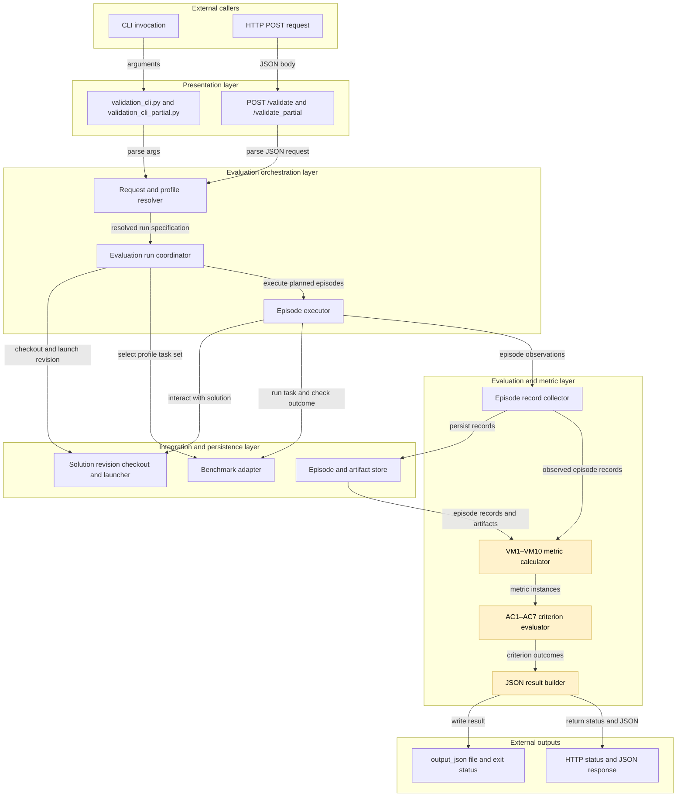
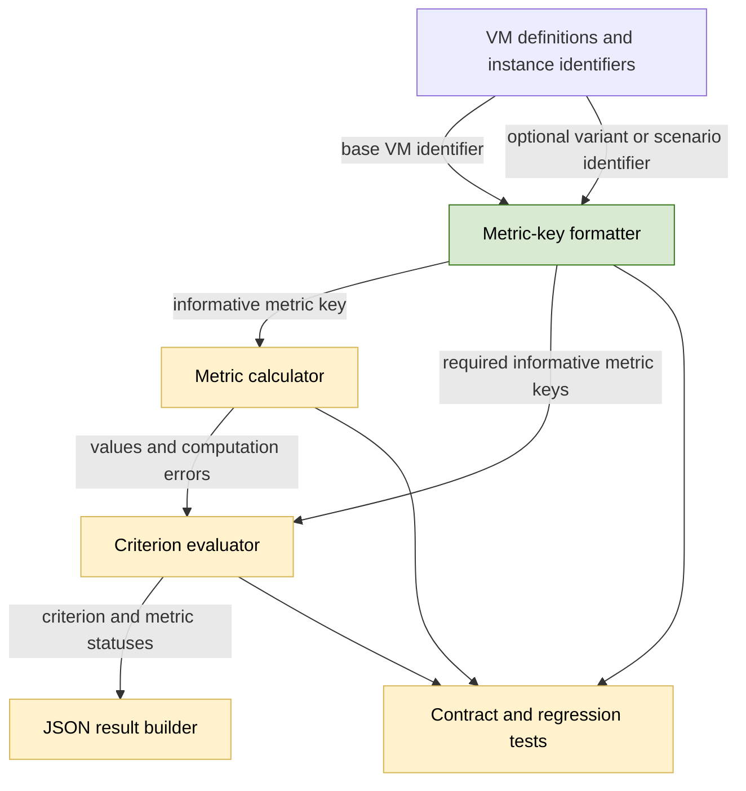

## Informative metric names

### 1. Requirement analysis

- **R1. Stable and informative keys.** Every `metrics_status` key must contain the stable VM identifier and an informative snake_case name. Do not emit a second legacy key for the same metric.
- **R2. Single-instance names.** Use these names:
  - `VM1/unperturbed_overall_success_rate`
  - `VM2/error_flag_precision`
  - `VM3/error_flag_recall`
  - `VM4/repeated_run_overall_success_rate_range`
  - `VM6/prompt_variant_overall_success_rate_range`
  - `VM8/transient_failure_overall_success_rate_range`
  - `VM9/maximum_action_attempts`
  - `VM10/timely_final_response_rate`
- **R3. Multiple-instance names.** Preserve the variant or scenario identifier after the informative name. Use `VM5/prompt_variant_overall_success_rate_loss/<variant-id>` and `VM7/transient_failure_overall_success_rate_loss/<scenario-id>`.
- **R4. Unchanged evaluation.** Use the VM identifier before the first slash to select thresholds and acceptance comparisons. Do not change metric formulas, computed values, criterion requirements, criterion statuses, HTTP statuses, or any field inside a metric status.
- **R5. Contract documentation and evidence.** Update the affected examples, interface documentation, and tests so they show the new keys consistently. Preserve the JSON result structure and the complete full and partial validation workflows.

Expected behavior variants:

- **B1. Single-instance metrics.** All eight single-instance keys use the R2 names.
- **B2. Multiple-instance metrics.** Every configured prompt variant and transient-failure scenario has one correctly named VM5 or VM7 instance, with no duplicate or missing instances.
- **B3. Full and partial validation.** Both scopes use the same naming scheme, while their existing populations and diagnostic meanings remain unchanged.

### 2. Tests

- **T1. Single-instance key contract.** Extend the independent metric fixture test to require the exact R2 key for every single-instance metric. Assert that `VM1`, `VM2`, `VM3`, `VM4`, `VM6`, `VM8`, `VM9`, and `VM10` are not present as bare keys. Covers B1 and R1–R2.
- **T2. Multiple-instance key contract.** Use at least two prompt variants and two failure scenarios to assert exact R3 keys, stable variant and scenario identifiers, and the absence of duplicate, missing, or legacy instance keys. Covers B2 and R3.
- **T3. Unchanged metric and criterion behavior.** Reuse independently calculated values and thresholds for accepted, valid, and invalid criteria. Assert that renaming keys changes neither values nor statuses, including zero-denominator and infrastructure-failure cases. Covers R4.
- **T4. Full and partial response contracts.** Run real CLI and HTTP validations and assert the new names in every `metrics_status` entry, the unchanged top-level result structure, and the expected full or partial scope. Covers B3 and R5.
- **T5. Documentation and regression suite.** Check affected examples and interface documentation for the new names and run the complete validation-service test suite, Ruff, and whitespace checks. Covers R5.

### 3. Implementation plan

#### 3.1 Implementation repos

https://github.com/anton-pershin/agent-validation — management and implementation repository.

#### 3.2 High-level design

The change affects only metric-key formatting and its consumers in the evaluation and metric layer. The following diagram preserves the validation-spec architecture and highlights those components.

A small metric-key formatter will own the R2 and R3 names. The calculator will use it when creating computation entries, and the criterion evaluator will use the same formatter when building required-metric lists. Existing VM-prefix comparisons will continue to select thresholds.

No execution, profile, provisioning, storage, or HTTP component requires a structural change.
