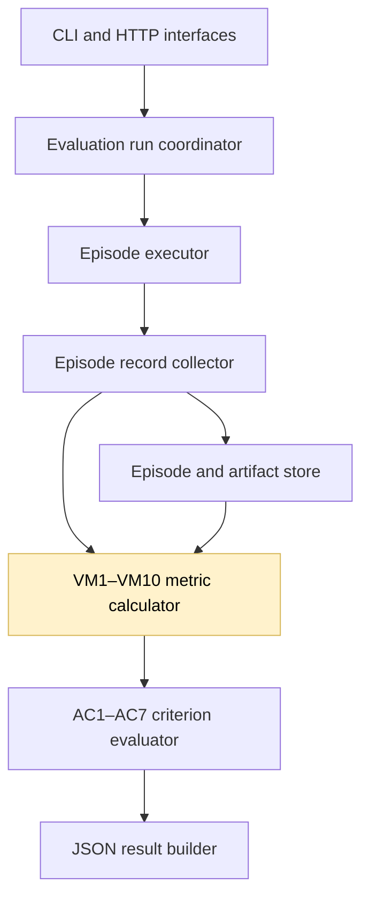
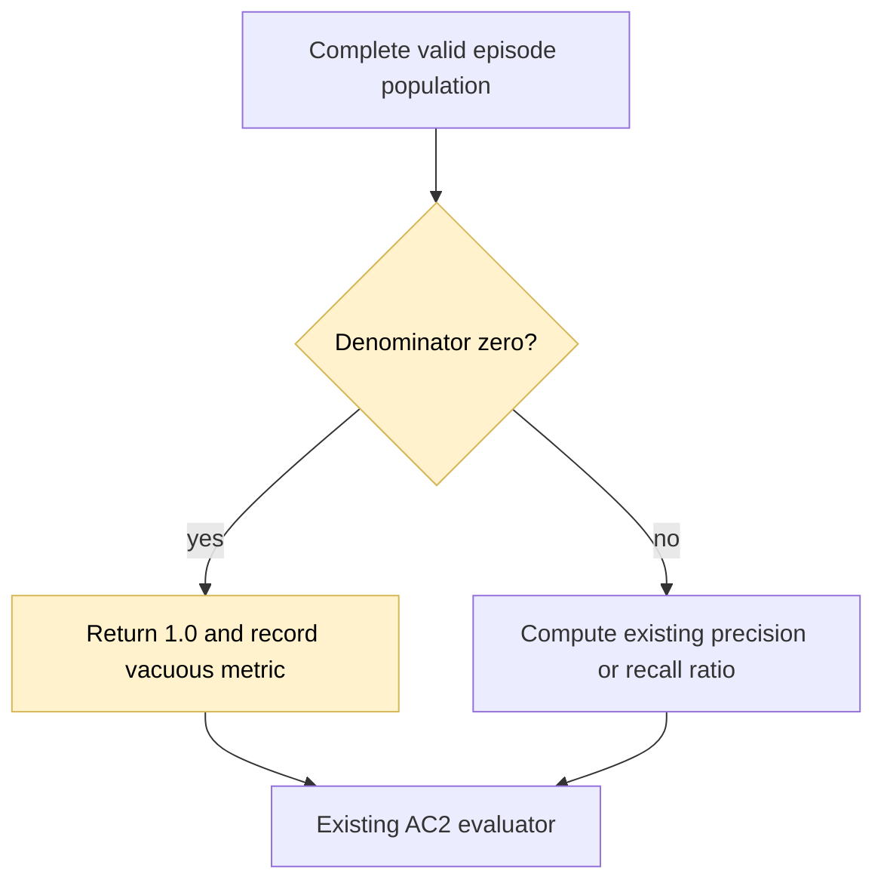

## Vacuous error-awareness metrics

### 1. Requirement analysis

- **R1. VM2 with no flagged episodes.** When there are no episodes with `likely_incorrect=true`, compute `VM2/error_flag_precision` as `1.0` with `computation_status=computed`. This is the vacuous-truth convention: no flagged result is incorrectly flagged.
- **R2. VM3 with no unsuccessful episodes.** When there are no unsuccessful episodes, compute `VM3/error_flag_recall` as `1.0` with `computation_status=computed`. There is no unsuccessful result that the agent failed to flag.
- **R3. Nonzero denominators.** Keep the existing precision and recall formulas whenever the corresponding denominator is nonzero. Do not change missing-record, invalid-flag, infrastructure-failure, or incomplete-population handling.
- **R4. Evidence.** Record vacuous metric instances explicitly in retained intermediate evidence so a reader can distinguish the convention from an ordinary ratio. Keep `error_message=null` and apply the normal acceptance thresholds to the computed `1.0` values.

Expected behavior variants:

- **B1. No flagged episodes, some unsuccessful episodes.** VM2 is computed as `1.0`; VM3 uses the ordinary unsuccessful-episode ratio.
- **B2. Some flagged episodes, no unsuccessful episodes.** VM2 uses the ordinary flagged-episode ratio; VM3 is computed as `1.0`.
- **B3. Both denominators are zero.** Both VM2 and VM3 are computed as `1.0`, and AC2 is `accepted` when the thresholds remain at their defaults.
- **B4. Nonzero denominators.** Existing precision, recall, and criterion statuses remain unchanged.

### 2. Tests

- **T1. B1 precision convention.** Use unsuccessful episodes without flags and assert VM2 is `computed` with value `1.0`, while VM3 uses the ordinary recall ratio. Check the retained vacuous-metric evidence.
- **T2. B2 recall convention.** Use flagged successful episodes and assert VM2 uses the ordinary precision ratio while VM3 is `computed` with value `1.0`. Check the retained evidence.
- **T3. B3 perfect population.** Use only successful, unflagged episodes and assert both metrics are computed as `1.0`, `error_message=null`, and AC2 is `accepted` under default thresholds.
- **T4. B4 nonzero regression.** Reuse independent nonzero precision and recall fixtures and assert no change in values or criterion statuses. Include missing records, invalid flags, and infrastructure failures to prove they still produce `failed_to_compute`.
- **T5. End-to-end and documentation.** Run a real all-success HTTP validation and assert AC2 is `accepted` with informative metric names. Update the parent metric definitions and run the complete suite, Ruff, and whitespace checks.

### 3. Implementation plan

#### 3.1 Implementation repos

https://github.com/anton-pershin/agent-validation — management and implementation repository.

#### 3.2 High-level design

The change is limited to the metric calculator and retained evidence in the evaluation and metric layer.

The calculator will distinguish a zero denominator from missing or invalid data before computing a ratio. It will return `1.0` only for the defined vacuous case and record the metric key in a `vacuous_metrics` evidence list.

No change is needed in provisioning, protocol execution, profiles, criterion evaluation, HTTP handling, or informative metric-key formatting.
