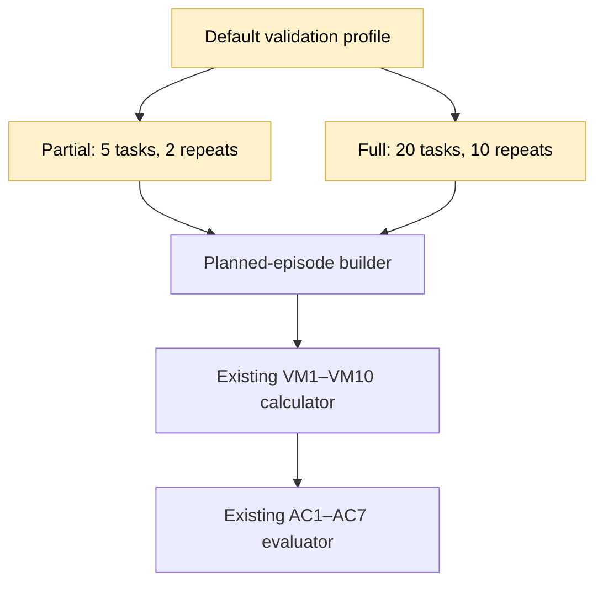
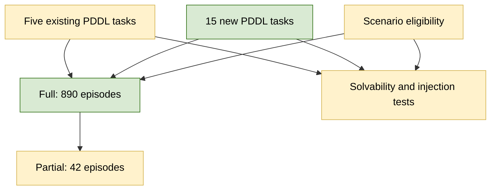

## Scale validation profile

### 1. Requirement analysis

- **R1. Partial population.** Change the `default` partial configuration to the current full population: five tasks, two repeats, two prompt variants, and both existing failure scenarios. Keep its 42 episodes and diagnostic meaning unchanged.
- **R2. Full population.** Change the `default` full configuration to 20 distinct tasks with 10 repeats per evaluation condition. Keep the same `concise` and `formal` prompt variants, thresholds, and metric definitions.
- **R3. Distinct and solvable tasks.** Keep the existing five tasks and add 15 tasks with distinct initial and goal states. Use only valid PDDL Blocks World actions and states that are solvable within 50 action attempts.
- **R4. Failure coverage.** Make `pick_up_failure` eligible for all 20 tasks. Make `unstack_failure` eligible for the nine tasks that start with stacked blocks: `unstack_ab`, `restack_abc`, `unstack_ba`, `unstack_ca`, `unstack_bc`, `restack_bca`, `restack_cab`, `restack_bac`, and `unstack_tower`. Every eligible task must have a valid solution that reaches its scheduled injection point.
- **R5. Explicit population sizes and documentation.** The full configuration must contain 890 episodes: 200 unperturbed, 200 concise, 200 formal, 200 `pick_up_failure`, and 90 `unstack_failure`. The partial configuration must contain 42 episodes. Document these sizes and the new task set.

Expected behavior variants:

- **B1. Existing partial run.** The profile plans exactly the former 42-episode full population.
- **B2. Expanded full run.** The profile plans exactly 890 episodes across 20 distinct tasks and 10 repeats.
- **B3. Solvability and fault coverage.** Every new task can be solved through public actions, and every failure-eligible task can reach its intended injection point.
- **B4. Metric compatibility.** Existing metric and criterion logic computes over the enlarged full population without changes to formulas or population matching.

### 2. Tests

- **T1. Exact population plans.** Assert 42 partial episodes and 890 full episodes. Check 10 repeats for every full condition, 200 episodes for each of unperturbed, concise, formal, and `pick_up_failure`, and 90 for `unstack_failure`. Covers B1–B2 and R1–R2.
- **T2. Task identity and PDDL validity.** Parse all 20 task files, require 20 unique identifiers and 20 unique initial-goal pairs, and verify all objects and predicates are supported. Covers R3.
- **T3. Solvability and action budget.** Execute a valid public solution for every task and assert the independent goal check succeeds within 50 action attempts. Covers B3 and R3.
- **T4. Fault-injection coverage.** For each eligible task, execute a solution that reaches the configured `pick_up` or `unstack` injection point. Assert all 20 tasks reach `pick_up` and all nine stacked tasks reach `unstack`. Covers B3 and R4.
- **T5. Metric and documentation compatibility.** Compute all metrics over the enlarged planned population with scripted successful episodes and assert no computation fails. Run a real partial HTTP validation, confirm the new profile documentation, and run the complete suite, Ruff, and whitespace checks. Covers B4 and R5.

### 3. Implementation plan

#### 3.1 Implementation repos

https://github.com/anton-pershin/agent-validation — management and implementation repository.

#### 3.2 High-level design

The change is limited to `config/profiles/default.yaml` and task definitions under `config/blocks_world/problems/`. Existing profile resolution and metric code consume the enlarged plans without modification.

The existing tasks remain unchanged. New PDDL files provide unique initial and goal states, and profile eligibility selects the failure scenarios. Tests execute public solution paths against the same Blocks World interpreter used by validation.

No provisioning, protocol, metric, criterion, HTTP, or storage code needs a structural change.
