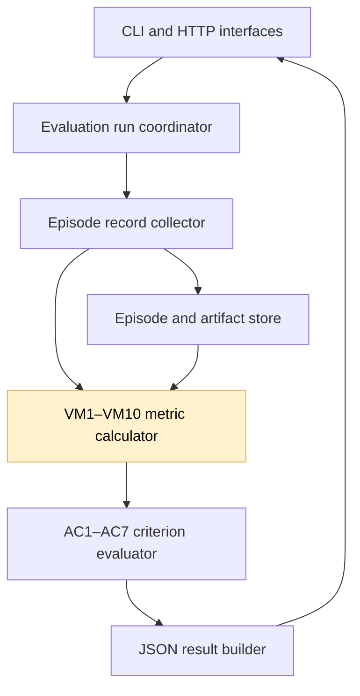
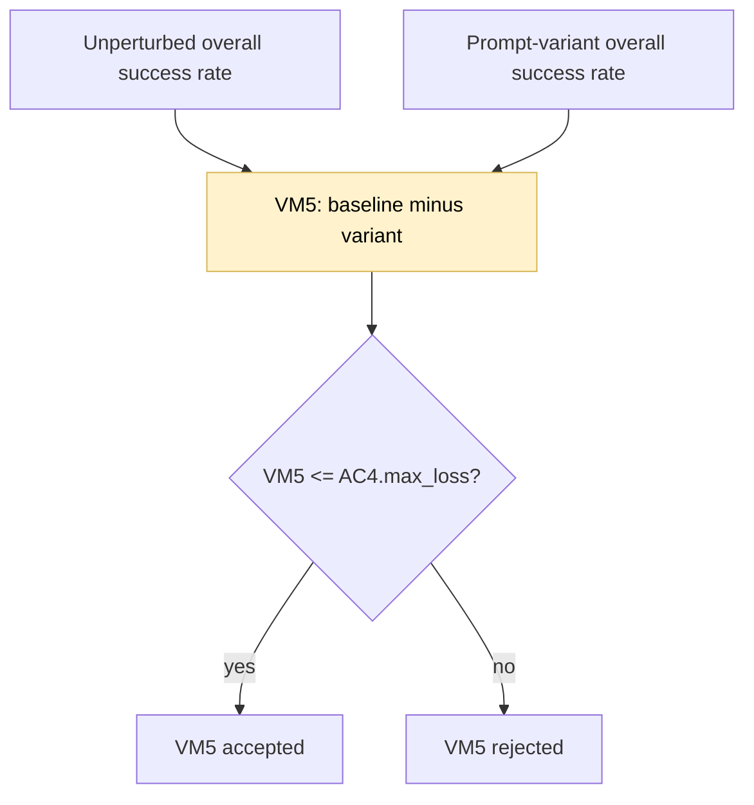

## Signed prompt-variant loss

### 1. Requirement analysis

- **R1. Signed VM5 values.** Compute each VM5 instance as `unperturbed overall success rate - variant overall success rate`. Do not clamp the result to zero. A positive value is a loss, zero means equal performance, and a negative value is a gain.
- **R2. Existing acceptance semantics.** Keep the AC4 condition `VM5 <= AC4.max_loss`. A negative gain satisfies this condition. Keep VM6 and all other metric definitions unchanged.
- **R3. Stable interfaces and evidence.** Keep the existing VM5 metric keys, result schema, per-task rates, and overall-rate evidence. Document the signed meaning of VM5.

Expected behavior variants:

- **B1. Variant loss.** When the unperturbed rate is greater than the variant rate, VM5 is positive and retains its existing value.
- **B2. Equal performance.** When the two rates are equal, VM5 is zero.
- **B3. Variant gain.** When the unperturbed rate is smaller than the variant rate, VM5 is negative. AC4 accepts that VM5 instance when its other required metrics also satisfy their conditions.

### 2. Tests

- **T1. Independent metric fixture.** Use a prompt variant whose overall success rate exceeds the unperturbed rate. Assert the exact negative VM5 value and retain independent positive-loss and range assertions. Covers B1–B3 and R1–R2.
- **T2. Gain acceptance.** Evaluate AC4 for the gaining variant and assert that its negative VM5 instance is accepted. Covers B3 and R2.
- **T3. Regression and documentation.** Run the complete test suite, Ruff, and whitespace checks. Confirm that the validation spec and README describe signed VM5 values and that no other metric formula changes. Covers R1–R3.

### 3. Implementation plan

#### 3.1 Implementation repos

https://github.com/anton-pershin/agent-validation — management and implementation repository.

#### 3.2 High-level design

The change is limited to VM5 in the evaluation and metric layer. Episode execution, population planning, stored evidence, criterion thresholds, and response serialization remain unchanged.

The calculator subtracts each variant rate from the unperturbed rate without applying a lower bound. The existing criterion evaluator compares the signed result with `AC4.max_loss`.

No change is needed in VM7, whose transient-failure loss definition remains clamped to zero.
