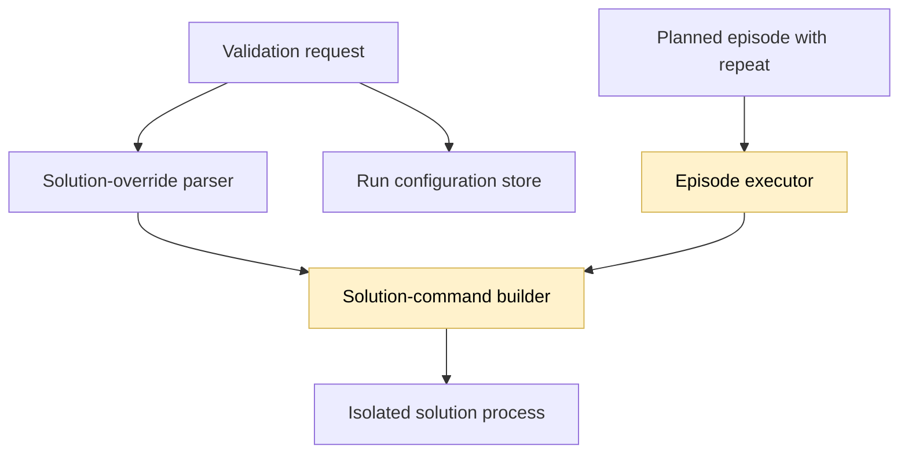
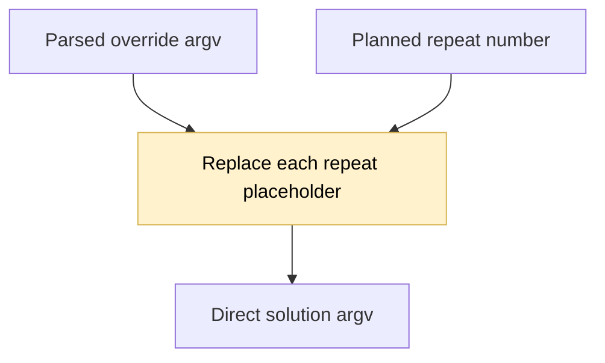

## Repeat-aware solution overrides

### 1. Requirement analysis

- **R1. Repeat placeholder.** Replace every `{repeat}` substring in a parsed solution-override argument with the planned episode's one-based repeat number. Apply the replacement after shell-like parsing and before starting the solution process.
- **R2. Repeat coverage.** Use the planned repeat for every condition and task. A full default run with `--seed {repeat}` must pass seeds 1 through 10 to the solution.
- **R3. Existing behavior and security.** Preserve arguments that contain no placeholder. Continue to pass arguments directly without shell execution. Keep the retained request-level `solution_overrides` unchanged so the run configuration records the original template.
- **R4. Documentation.** Document the placeholder in the common CLI and HTTP contract and in the solution interface.

Expected behavior variants:

- **B1. Separate argument.** `--seed {repeat}` becomes `--seed 1` for repeat 1 and `--seed 10` for repeat 10.
- **B2. Embedded argument.** `--seed=repeat-{repeat}` becomes `--seed=repeat-2` for repeat 2.
- **B3. Ordinary overrides.** Arguments without `{repeat}` remain unchanged.

### 2. Tests

- **T1. Command construction.** Construct solution commands for repeats 1, 2, and 10. Assert the exact substituted argument lists for separate and embedded placeholders and assert that ordinary arguments remain unchanged. Covers B1–B3 and R1–R3.
- **T2. Episode integration.** Verify that episode execution supplies the planned repeat when it requests the solution command. Covers R1–R2.
- **T3. Regression and documentation.** Run the complete test suite, Ruff, and whitespace checks. Confirm that the documentation describes the placeholder and that overrides still run without a shell. Covers R3–R4.

### 3. Implementation plan

#### 3.1 Implementation repos

https://github.com/anton-pershin/agent-validation — management and implementation repository.

#### 3.2 High-level design

The change affects solution-command construction in the integration layer and the planned-repeat value supplied by the episode executor. Parsing, request retention, provisioning, protocol execution, and metric computation remain unchanged.

The command builder substitutes the repeat independently in each argv item. It does not join the items into a command string.

No profile, result-schema, or metric changes are required.
