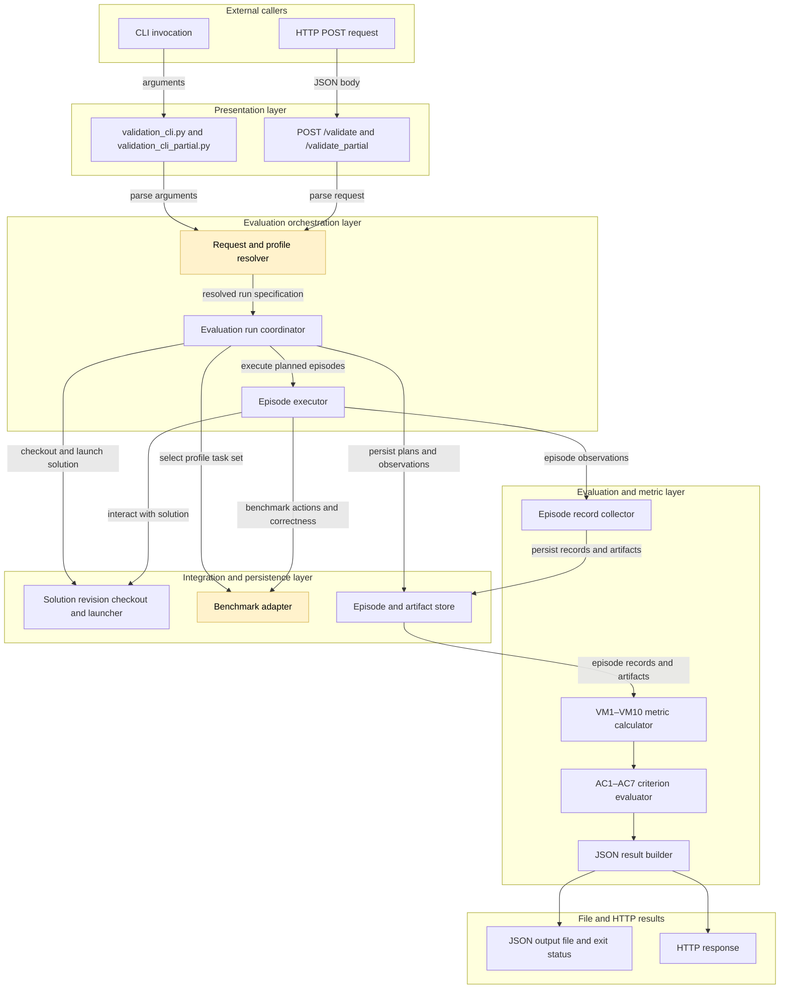
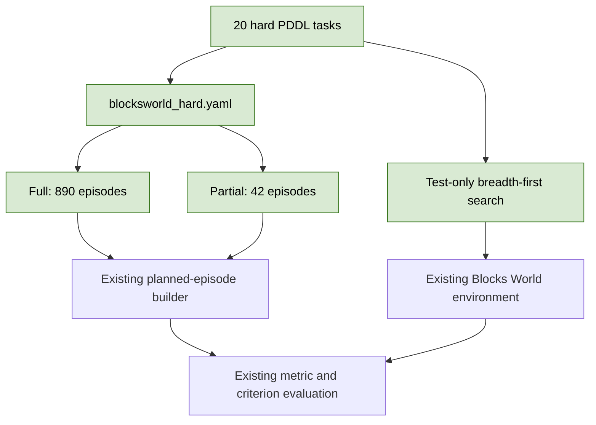

## Blocks World hard profile

### 1. Requirement analysis

- **R1. Separate hard profile.** Add the `blocksworld_hard` validation profile for `reliable-agent`. Keep the `default` profile unchanged. Use the existing original instructions, `concise` and `formal` prompt variants, AC1–AC7, and default acceptance thresholds.
- **R2. Full population.** Use 20 distinct Blocks World tasks and 10 repeats. Include the unperturbed condition, both prompt variants, `pick_up_failure` for all 20 tasks, and `unstack_failure` for nine selected tasks. The full population must contain exactly 890 episodes: 200 unperturbed, 200 concise, 200 formal, 200 `pick_up_failure`, and 90 `unstack_failure` episodes.
- **R3. Partial population.** Use five tasks and two repeats. Include both prompt variants, `pick_up_failure` for four tasks, and `unstack_failure` for two tasks. The partial population must contain exactly 42 episodes and remain diagnostic.
- **R4. Planning difficulty.** Use tasks whose shortest successful plans contain eight, ten, or twelve state-changing movement actions. Include six eight-action tasks, eight ten-action tasks, and six twelve-action tasks. The arithmetic mean of the 20 shortest-plan lengths must be exactly ten actions. Do not count action-catalog requests, rejected actions, injected failures, or retries as plan actions.
- **R5. Valid and distinct tasks.** Use only the PDDL predicates and public actions supported by the existing Blocks World adapter. Give every task a distinct initial-state and goal pair. Every task must have a successful shortest plan within the 50-action-attempt limit.
- **R6. Failure coverage.** Every task must have a successful shortest plan that contains `pick_up`. Each of the nine tasks selected for `unstack_failure` must have a successful shortest plan that contains `unstack`.
- **R7. Documentation.** Document the new profile, its difficulty measure, and its population sizes in the README. Add the profile to Section 4 of the validation spec through the manual approval workflow.

Expected behavior variants:

- **B1. Existing default validation.** The `default` profile retains its current tasks, thresholds, and 890-episode full and 42-episode partial populations.
- **B2. Hard full validation.** The `blocksworld_hard` full configuration plans 890 episodes with the condition counts in R2.
- **B3. Hard partial validation.** The `blocksworld_hard` partial configuration plans 42 episodes with the condition counts in R3.
- **B4. Measured planning difficulty.** An independent shortest-path search confirms every required plan length and the exact mean of ten actions.
- **B5. Compatible evaluation.** Existing episode execution, metric calculation, and criterion evaluation support the new profile without structural changes.

### 2. Tests

- **T1. Exact hard populations.** Load `blocksworld_hard` and assert 890 full episodes and 42 partial episodes. Assert all per-condition counts and repeat identifiers from R2 and R3. Covers B2, B3, R2, and R3.
- **T2. Shortest-plan difficulty.** Parse all hard tasks and use an independent breadth-first search over Blocks World states to find each shortest successful plan. Assert six eight-action plans, eight ten-action plans, six twelve-action plans, and a mean length of ten. Covers B4 and R4.
- **T3. Task validity and failure coverage.** Assert 20 unique task identifiers and 20 unique initial-state and goal pairs. Execute every shortest plan through `BlocksWorldEnvironment`, assert goal satisfaction, and assert the action coverage from R6. Covers R5 and R6.
- **T4. Metric compatibility.** Compute all metrics and criteria over the complete planned hard population with scripted successful episode records. Assert that every metric computes and every criterion is accepted. Covers B5.
- **T5. Service and regression checks.** Run an actual partial validation with `blocksworld_hard` and the local scripted solution. Assert 42 successful episode records, 12 fault exposures, and accepted AC1–AC7 results. Assert that the default population counts remain 890 and 42. Check the profile documentation. Run the complete test suite, Ruff, and whitespace checks. Covers B1, B3, B5, and R7.

### 3. Implementation plan

#### 3.1 Implementation repos

https://github.com/anton-pershin/agent-validation — management and implementation repository.

#### 3.2 High-level design

The change adds profile configuration and PDDL task data. The existing presentation, orchestration, metric, and solution-adapter components remain unchanged. The profile resolver and Blocks World benchmark adapter consume the new configuration through their existing interfaces.

A new directory separates the hard problems from the default problems. A test-only shortest-path search measures difficulty independently from the hand-written PDDL files and the execution adapter. Expected plan lengths remain test data; the production profile schema does not change.

No provisioning, protocol, metric, criterion, HTTP, storage, or solution code needs a structural change.
