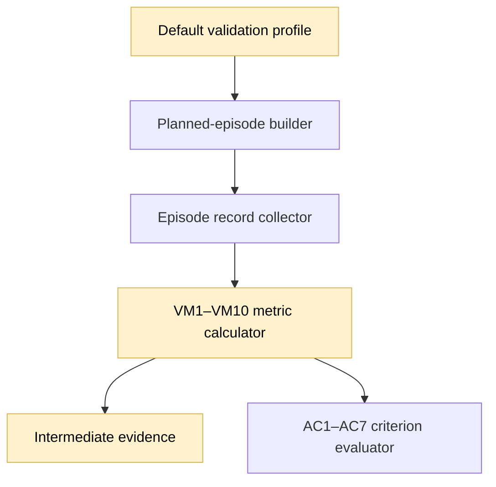
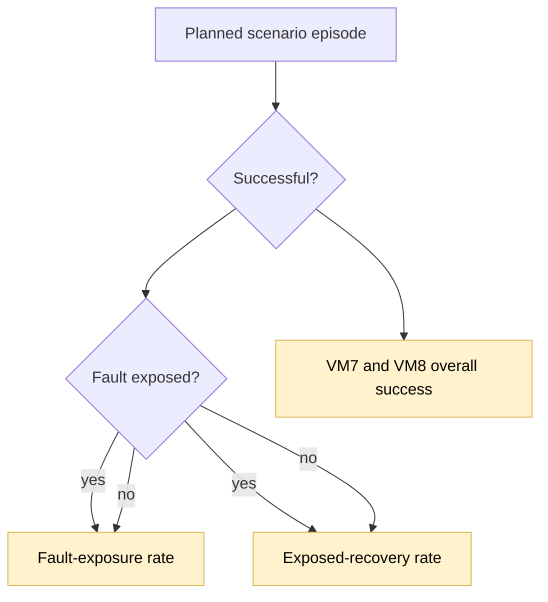

## Coverage-aware transient resilience

### 1. Requirement analysis

- **R1. Necessary pick-up exposure.** Remove `unstack_ab`, `unstack_ba`, `unstack_bc`, `unstack_ca`, and `unstack_tower` from the full `pick_up_failure` population. These tasks have valid solutions that do not call `pick_up`. Keep the partial population unchanged. The full `pick_up_failure` population must contain 15 tasks, and the common full task set for `pick_up_failure` and `unstack_failure` must be `restack_abc`, `restack_bca`, `restack_cab`, and `restack_bac`.
- **R2. Updated full population.** Keep 20 benchmark tasks and 10 repeats. The full profile must plan 840 episodes: 200 unperturbed, 200 concise, 200 formal, 150 `pick_up_failure`, and 90 `unstack_failure`. The partial profile must still plan 42 episodes.
- **R3. Overall scenario success.** Compute VM7 and VM8 over all planned episodes in their comparison populations. Count successful episodes without fault exposure as successful and unsuccessful episodes without fault exposure as unsuccessful. Missing fault exposure alone must not cause `failed_to_compute`. Keep the existing VM7 and VM8 formulas, metric keys, and AC5 thresholds.
- **R4. Exposure evidence.** For every selected failure scenario, retain its overall and per-task fault-exposure rates: exposed planned episodes divided by all planned episodes.
- **R5. Exposed-recovery evidence.** For every selected failure scenario, retain per-task exposed-recovery success rates: successful exposed episodes divided by exposed episodes. Compute the overall exposed-recovery rate as the arithmetic mean of per-task rates for tasks with at least one exposed episode. Use `null` for a task with no exposed episodes and for the overall rate when no task has exposure. Never count a non-exposed episode as recovery evidence.
- **R6. Documentation and compatibility.** Keep the result schema unchanged and store the new evidence in `intermediates.json`. Document the population, overall-success semantics, exposure rate, and exposed-recovery rate.

Expected behavior variants:

- **B1. Successful non-exposed episode.** It counts as successful in VM7 and VM8 but contributes to neither the exposure numerator nor any exposed-recovery rate.
- **B2. Unsuccessful non-exposed episode.** It counts as unsuccessful in VM7 and VM8 and contributes no exposure or recovery success.
- **B3. Exposed episode.** It contributes to the exposure numerator and, when successful, to the recovery numerator.
- **B4. No exposure.** VM7 and VM8 remain computable; exposure is zero and exposed recovery is `null`.
- **B5. Full planning.** The full profile plans 840 episodes with the corrected eligible task sets. The partial profile remains unchanged.

### 2. Tests

- **T1. Exact populations and eligibility.** Assert 840 full episodes and 42 partial episodes, exact condition counts, the 15-task pick-up population, and the four-task common scenario population. Covers R1–R2 and B5.
- **T2. Non-exposed outcome semantics.** Use successful and unsuccessful non-exposed records and assert that VM7 and VM8 retain their independent overall-success values and produce no exposure-related error. Covers B1–B2 and R3.
- **T3. Exposure and recovery evidence.** Use mixed exposed and non-exposed records and assert exact overall and per-task exposure and exposed-recovery rates. Include all-false exposure and assert zero exposure and `null` recovery without a metric error. Covers B1–B4 and R4–R5.
- **T4. Regression and documentation.** Run the complete suite, Ruff, and whitespace checks. Confirm that existing VM7 and VM8 values, result schemas, missing-record handling, and infrastructure-failure handling remain unchanged except for the removal of exposure-only failures. Update the validation spec and README. Covers R3–R6.

### 3. Implementation plan

#### 3.1 Implementation repos

https://github.com/anton-pershin/agent-validation — management and implementation repository.

#### 3.2 High-level design

The profile planner receives the smaller pick-up task set. The metric calculator removes the all-or-nothing exposure guard and records coverage evidence while computing overall scenario success over all planned episodes.

Exposure and recovery use the same planned records but answer different questions. Overall scenario success includes every outcome. Exposure counts only confirmed injected faults. Exposed recovery counts only successful exposed episodes.

No result-schema, criterion-threshold, protocol, provisioning, or solution-interface change is required.
