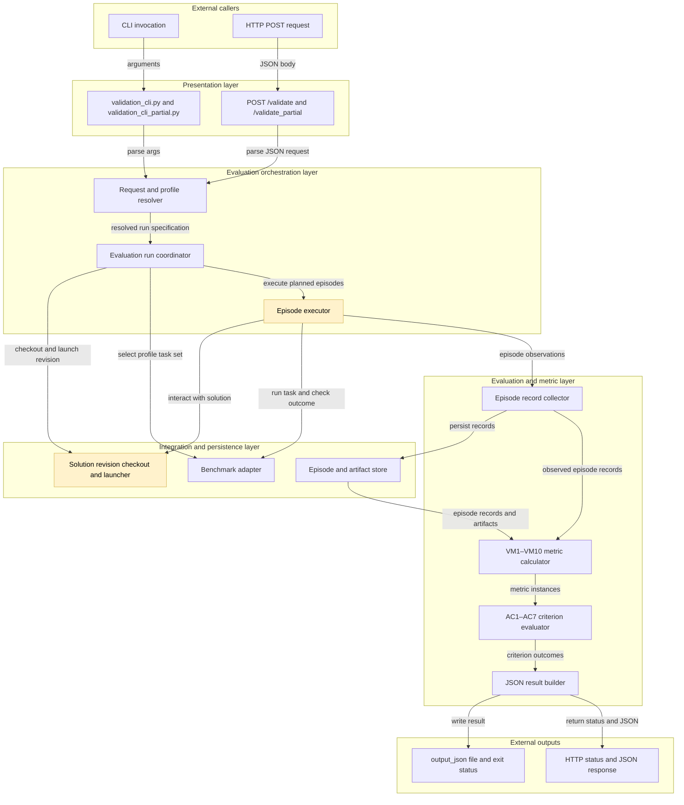
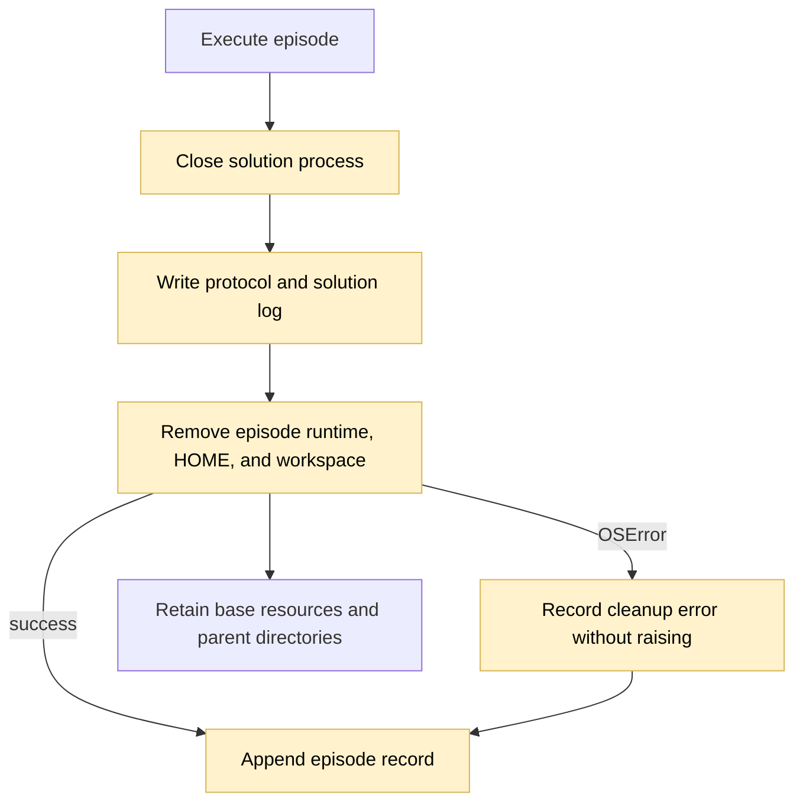

## Per-episode temporary-resource cleanup

### 1. Requirement analysis

- **R1. Per-episode cleanup.** Remove the episode runtime copy, HOME, and workspace when the episode ends. Close the solution process before removal. Do not retain these resources until whole-run cleanup.
- **R2. All episode outcomes.** Apply R1 after success, solution failure, timeout, and infrastructure failure. Apply it also when setup fails before all three resources exist.
- **R3. Bounded temporary resources.** During normal execution, each of `episode-runtimes/`, `homes/`, and `workspaces/` must contain no more entries than the number of active episodes. The configured `episode_concurrency` bounds this number for one run. Remove each episode's cached runtime path with its directory.
- **R4. Cleanup failure safety.** Try to remove all three resources even if one removal fails. Do not raise an episode-cleanup exception. Record an `OSError` in `RevisionPreparer.cleanup_error`, including the episode identifier. The existing run-failure path must retain episode evidence and report the cleanup error.
- **R5. Isolation and evidence.** Keep the base checkout, base virtual environment, and resource parent directories available for later episodes. Do not move or remove episode evidence. Preserve independent runtime, HOME, and workspace state while each episode is active.
- **R6. Existing contracts.** Do not change the solution protocol, validation result schema, metrics, acceptance criteria, or profile format. Existing documentation remains valid because it does not require episode resources to persist for the whole run.

Expected behavior variants:

- **B1. Completed episode.** Its three resource directories and cached runtime path are removed after process closure and evidence writing.
- **B2. Failed episode.** Solution failure, timeout, and infrastructure failure use the same cleanup path as B1.
- **B3. Partial setup.** Missing resource directories do not prevent cleanup of the directories that exist.
- **B4. Concurrent episodes.** Each episode is cleaned independently. Completed episodes do not consume temporary space while other episodes remain active.
- **B5. Removal failure.** Cleanup records the error without raising, attempts the remaining removals, and leaves the already written evidence available.

### 2. Tests

- **T1. Resource removal.** Create all three directories and a cached runtime path for an episode. Call episode cleanup and assert that only those episode resources are removed. Call it again with missing directories and assert that it does not raise. Covers R1, R3, R5, B1, and B3.
- **T2. Removal failure.** Simulate an `OSError` for one resource. Assert that cleanup does not raise, records the episode identifier and error, evicts the cached path, and attempts the other removals. Covers R4 and B5.
- **T3. Executor outcomes.** Verify cleanup after successful episodes, the existing solution-failure cases, timeout, and an infrastructure failure before resource setup. Assert that cleanup follows process closure and that normal episode records and logs remain available. Covers R1, R2, R5, B1, and B2.
- **T4. Concurrent bound.** Run the existing concurrent isolation scenario with `episode_concurrency = 2`. Observe all three parent directories during execution. Assert that no parent has more than two entries, every episode is cleaned once, and each completed episode's directories are absent. Keep the existing state-isolation assertions. Covers R2, R3, R5, and B4.
- **T5. Evidence after cleanup failure.** Run one episode while one resource removal fails. Assert a provisioning failure with a recorded cleanup error and retained run, protocol, solution-log, and episode-record evidence. Covers R4 and B5.
- **T6. Regression and full-scope check.** Run the complete test suite, Ruff, and whitespace checks. Run a full validation with the local scripted solution and observe the three resource parents. Confirm that their entry counts never exceed `episode_concurrency`. Covers R1–R6.

### 3. Implementation plan

#### 3.1 Implementation repos

https://github.com/anton-pershin/agent-validation — management and implementation repository.

#### 3.2 High-level design

The episode executor gains an unconditional per-episode cleanup step. The solution revision checkout and launcher removes the three episode-owned resources and records cleanup errors. Other layers do not change.

A nested cleanup boundary ensures that episode resource removal runs after process closure and evidence writing, including when an earlier operation raises. `RevisionPreparer` owns resource removal and non-raising error recording. `EpisodeExecutor` retains responsibility for the episode lifecycle and record creation.

No terminology, validation-spec, documentation, or configuration change is required.
