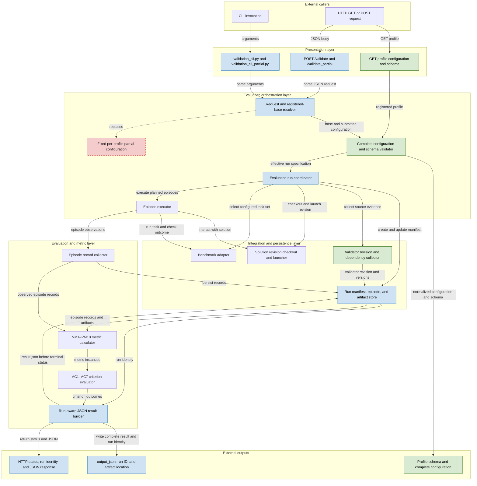

## Flexible validation contract

### 1. Executive summary

#### 1.1 Spec description

The implementation will replace fixed per-profile full and partial populations with registered full-validation profiles and caller-supplied complete partial configurations. It will expose each profile's normalized configuration and JSON Schema, align the CLI and HTTP interfaces, and return run identity with every result. It will also complete run manifests with validator provenance and lifecycle evidence while preserving the existing VM1–VM10 and AC1–AC7 behavior.

#### 1.2 Spec motivation

The revised SDD contract requires full validation to use a registered configuration unchanged and permits partial validation to modify any configuration setting for diagnostic feedback. The current fixed partial subsections cannot support that workflow, and callers cannot discover run evidence from the returned result. Exact validator provenance and consistent run lifecycle records are necessary to make validation evidence attributable and auditable.

#### 1.3 Implementation repos

https://github.com/anton-pershin/agent-validation — management and implementation repository.

### 2. Requirement analysis

This spec supersedes the fixed full/partial configuration requirements and associated tests and diagrams in specs 01, 04, 08-blocksworld-hard-profile, and 07-coverage-aware-transient-resilience. In spec 01, this includes FR2 and AC4, the incomplete result and error fields in FR13–FR14 and AC9, and the incomplete run-evidence requirements in FR11, NFR3, and AC10. Other requirements in those specs remain in force unless explicitly marked as superseded. This spec also implements the revised validation-spec contract without changing metric definitions, criterion formulas, benchmark correctness rules, or solution protocol semantics.

#### 2.1 Functional requirements

- **FR1. Registered full profiles.** Store `default` and `blocksworld_hard` as registered full-validation configurations without predefined partial subsections. Preserve their complete settings and respective 840 and 890 episode populations. Full validation must use the selected registered profile unchanged. Record `default` as the authoritative profile for `reliable-agent` project-level acceptance and `blocksworld_hard` as supplementary.
- **FR2. Configuration discovery.** Provide `GET /profiles/{profile}/configuration` with the registered profile name, complete normalized configuration, and corresponding machine-readable JSON Schema. Return HTTP `404` for an unknown profile. The returned configuration must be editable and resubmittable without exposing secrets.
- **FR3. Complete partial configurations.** Resolve a registered base profile and validate a caller-supplied complete modified copy against its schema and reference rules. Reject malformed content, missing fields, unknown fields, invalid values, and invalid references. Do not merge a patch or silently reconstruct omitted fields from defaults. Keep base identity and base-directory path resolution separate from the effective configuration.
- **FR4. Partial CLI.** Require `partial_config` in `validation_cli_partial.py`. Load a complete YAML or JSON configuration, select its registered base through `profile`, and perform diagnostic validation. Full CLI behavior remains unchanged except for run-aware output and errors.
- **FR5. HTTP validation scopes.** Keep `/validate` restricted to the active registered full profile and reject inline configuration. Extend `/validate_partial` with a required complete `configuration` and optional base `profile`, defaulting to the service's active profile. Preserve existing HTTP status behavior for completed, malformed, and failed requests.
- **FR6. Run-aware results and errors.** Add `run_id` and `artifacts_location` to the common result, CLI `output_json`, HTTP responses, and stored `result.json`. Return the same identifiers in errors raised after run creation. Keep `profile` as the registered base profile and do not add an implementation-outcome field. The CLI must print the run identity and write the same complete response object stored in `result.json`.
- **FR7. Run initialization and lifecycle.** Allocate a unique run ID and new directory after request/configuration validation and before provisioning. Create an initial `running` manifest immediately, retry collisions without reusing evidence, and support `completed`, `failed`, and cooperative `aborted` terminal states. Carry run context through application errors.
- **FR8. Validator provenance.** Record the exact validator Git revision and clean/dirty state. Capture staged, unstaged, and untracked source changes and their diff when present. Record runtime, platform, complete validator dependency versions, and resolved solution dependency versions. A run that cannot establish required validator provenance must fail explicitly rather than substitute the package version.
- **FR9. Complete resolved evidence.** Record the run directory, solution repository, requested and verified commits, solution overrides, validation scope, registered base profile and hash, complete effective configuration and hash, and references to retained artifacts. Preserve the existing requested/verified commit, episode, metric, intermediate, and provisioning evidence.
- **FR10. Terminal evidence protection.** Write `result.json` before marking a run `completed`. Reject service writes after any terminal status and ensure that later runs cannot alter earlier evidence. `result.json` is mandatory for every completed run and not required for failed or aborted runs.
- **FR11. Examples and launchers.** Move the former 42-episode partial populations to unregistered example configurations outside `config/profiles/`. Provide `validation_service.py` as a thin HTTP launcher accepting `port=<port>` and `profile=<registered profile>`, with profile `default` by default, while preserving the equivalent `agent-validation-api` console entry point.
- **FR12. Documentation and specification cleanup.** Update README, solution-interface documentation, terminology, the parent validation spec, and `.github/pull_request_template.md` together with the behavior. Correct the stale default-population assertion in the hard-profile spec, add explicit supersession notes to every affected fixed-partial requirement, test, and diagram in specs 04, 08-blocksworld-hard-profile, and 07-coverage-aware-transient-resilience, and renumber the later hard-profile spec from 07 to 08 to resolve duplicate numbering.

#### 2.2 Non-functional requirements

- **NFR1. Security.** Keep credentials out of configuration-discovery responses, results, manifests, diffs, logs, and artifacts. Apply explicit redaction to newly retained provenance. Do not redact non-sensitive resolved values such as token-count limits.
- **NFR2. Reproducibility.** Bind every result and terminal error to its run evidence and every completed run to exact solution and validator revisions, effective configuration, dependencies, and execution scope.
- **NFR3. Compatibility of evaluation semantics.** Reuse the existing episode planner logic, metric calculator, criterion evaluator, benchmark adapter, and solution protocol. Existing full-profile population and metric regression tests must remain valid except for the removal of fixed partial configuration assumptions.
- **NFR4. Maintainability.** Use typed request, response, configuration, and manifest contracts. Keep registration metadata separate from mutable partial settings and keep presentation, orchestration, provenance, and persistence responsibilities separate.
- **NFR5. Failure isolation.** Request and schema failures before run allocation need no synthetic run record. Once allocated, failures and cooperative cancellation must retain run identity and partial evidence without corrupting other runs.
- **NFR6. Operability.** Document a fetch–modify–submit partial-validation workflow through both CLI and HTTP. Keep all automated tests independent of a real model provider.

### 3. Acceptance criteria

- **AC1. Registered profiles and examples.** Tests must prove that registered profiles contain full-validation settings only, that their full populations remain 840 and 890 episodes, and that each former 42-episode population is available as an unregistered example. Partial example changes must not alter registered profile hashes.
- **AC2. Discovery and strict completeness.** Interface tests must retrieve each profile's schema and complete configuration, submit the returned configuration unchanged as a partial run, and verify the base profile and effective configuration. Tests must reject missing nested fields, unknown fields, wrong types, invalid values, invalid references, malformed files, and unknown base profiles. The discovery response and submitted configuration must contain no test secrets.
- **AC3. CLI and HTTP scope contract.** Tests must exercise both CLIs and all three HTTP endpoints. They must show that full runs use registered configuration unchanged, partial CLI requires `partial_config`, partial HTTP requires `configuration`, optional HTTP `profile` selects the base, and inline full configuration is rejected. Completed valid and invalid results retain HTTP `200`; caller errors and request-level failures retain their documented statuses.
- **AC4. Arbitrary diagnostic configuration.** Tests must modify populations, thresholds, criterion scope, timing, resources, variants, and failure scenarios in partial copies. One partial configuration must be as large as its registered full population. All-green partial criteria must remain `accepted` at criterion level while `validation_scope` remains `partial`; no overall acceptance certification may be produced.
- **AC5. Run-aware responses and errors.** CLI, HTTP, and `result.json` tests must assert identical required metadata and complete in-scope AC/VM outcomes. Provisioning and execution failures after allocation must expose the same run ID and artifact location as the manifest. Malformed pre-allocation requests must not acquire synthetic run IDs.
- **AC6. Manifest lifecycle and provenance.** Tests must observe an initial `running` manifest before provisioning, then completed, failed, and aborted transitions. They must cover clean and dirty validator repositories, including staged, unstaged, and untracked changes, and assert exact revision and diff evidence. Runtime, platform, validator dependencies, solution dependencies, requested/verified commits, and complete resolved configuration must be present.
- **AC7. Evidence integrity.** Concurrent and sequential runs must receive distinct IDs and directories. A simulated ID collision must be retried. `result.json` must exist and match the returned result for every completed run, including one with invalid criteria. Post-terminal writes must fail without changing evidence bytes, and a later run must leave the first run's evidence unchanged.
- **AC8. Redaction accuracy.** Tests must place credentials in configuration, environment, logs, errors, and validator changes and verify their absence from public responses and retained evidence. They must also verify that `--plan-max-output-tokens` and its numeric value remain intact while actual token credentials are redacted.
- **AC9. Evaluation regressions.** Existing VM1–VM10 and AC1–AC7 unit tests, Blocks World semantics tests, fault-exposure evidence tests, isolation tests, and resource-cleanup tests must pass. Metric recomputation from retained episode evidence must use the effective submitted configuration and match the returned values.
- **AC10. Documentation and clean-environment verification.** Documentation must describe registered full profiles, unregistered examples, configuration discovery, complete partial submission, result identity, all run statuses, evidence, and cleanup. `.github/pull_request_template.md` must contain Summary, Design, Example, and Evidence sections. A clean-environment check must install the package, verify the HTTP launcher's port and profile arguments and default profile, start the service, and run one partial CLI and one partial HTTP validation against the local scripted solution using an example configuration. The complete test suite and Ruff must pass without a real model provider.

### 4. High-level solution design

The parent architecture remains layered. The following parent diagram highlights modified components in blue, new components in green, and the removed fixed partial configuration in red.

The component design separates base registration from the effective configuration and introduces one run-aware response path. The manifest starts with minimal identity and accumulates provenance and execution evidence before a terminal transition.

```mermaid
flowchart LR
  subgraph Resolution[Configuration resolution]
    Base[Registered base YAML]
    Norm[Normalized complete configuration]
    Schema[Complete-submission JSON Schema]
    Copy[Complete modified copy]
    Effective[Effective configuration plus immutable base identity]
    Base --> Norm
    Norm --> Schema
    Norm --> Copy
    Base -->|identity and base directory| Effective
    Norm -->|full validation| Effective
    Copy -->|partial validation: strict schema and references| Effective
  end
  subgraph Run[Run lifecycle]
    Allocate[Unique ID and new directory]
    Running[Immediate running run.json]
    Execute[Provision and execute episodes]
    Result[Complete run-aware result]
    Terminal[completed, failed, or aborted]
    Allocate --> Running
    Running --> Execute
    Execute --> Result
    Result -->|result.json first| Terminal
    Execute -->|run-aware error or cancellation| Terminal
  end
  Effective --> Allocate
  subgraph Outputs[Caller and evidence]
    CLIOut[CLI output_json and run identity]
    HTTPOut[HTTP result or run-aware error]
    Evidence[Sealed run directory]
  end
  Result --> CLIOut
  Result --> HTTPOut
  Terminal --> Evidence
  classDef created fill:#d9ead3,stroke:#38761d,color:#000000
  classDef modified fill:#cfe2f3,stroke:#3d85c6,color:#000000
  class Schema,Copy,Allocate,Running,Terminal created
  class Base,Norm,Effective,Execute,Result,CLIOut,HTTPOut,Evidence modified
```

For full validation, the normalized registered configuration flows directly to `Effective`; no caller configuration is accepted. For partial validation, `Copy` is mandatory and must pass completeness, schema, and reference validation. `profile` in every result identifies `Base`, while the manifest retains both `Base` and `Effective`. Existing metric and benchmark components consume `Effective` without scope-specific calculation changes.
