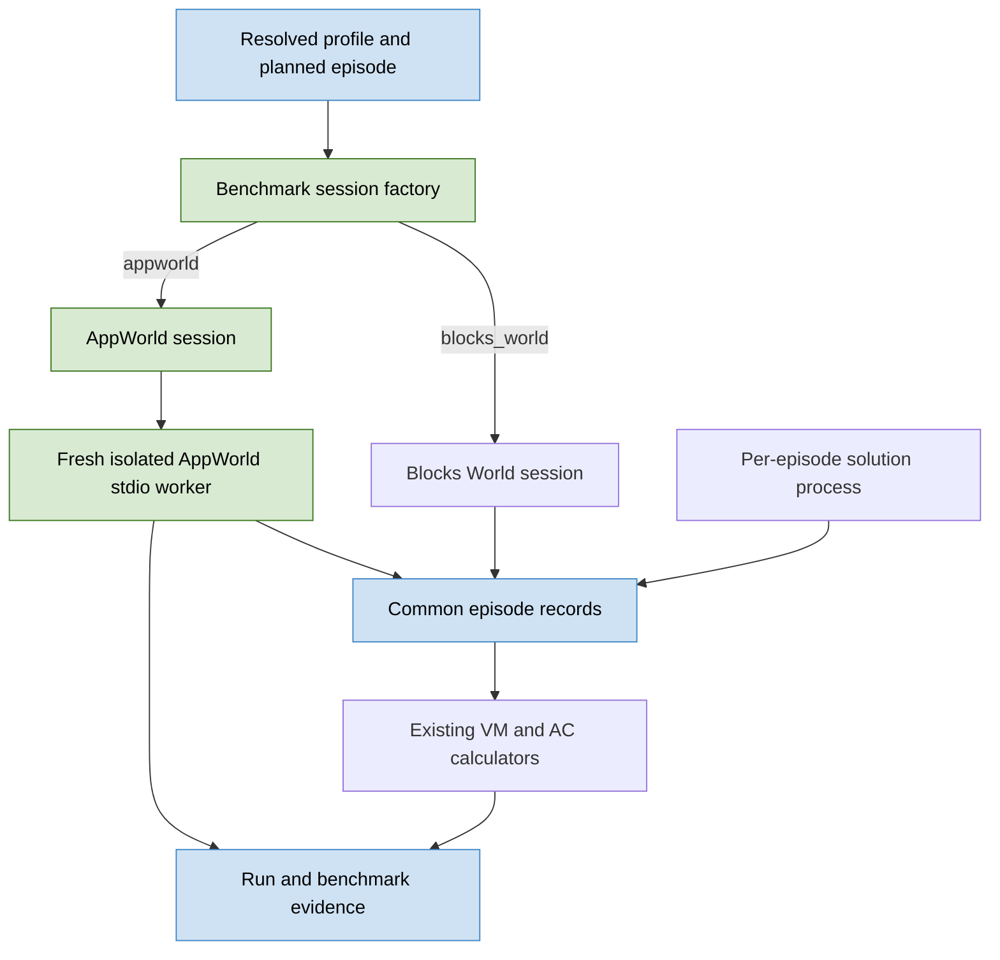
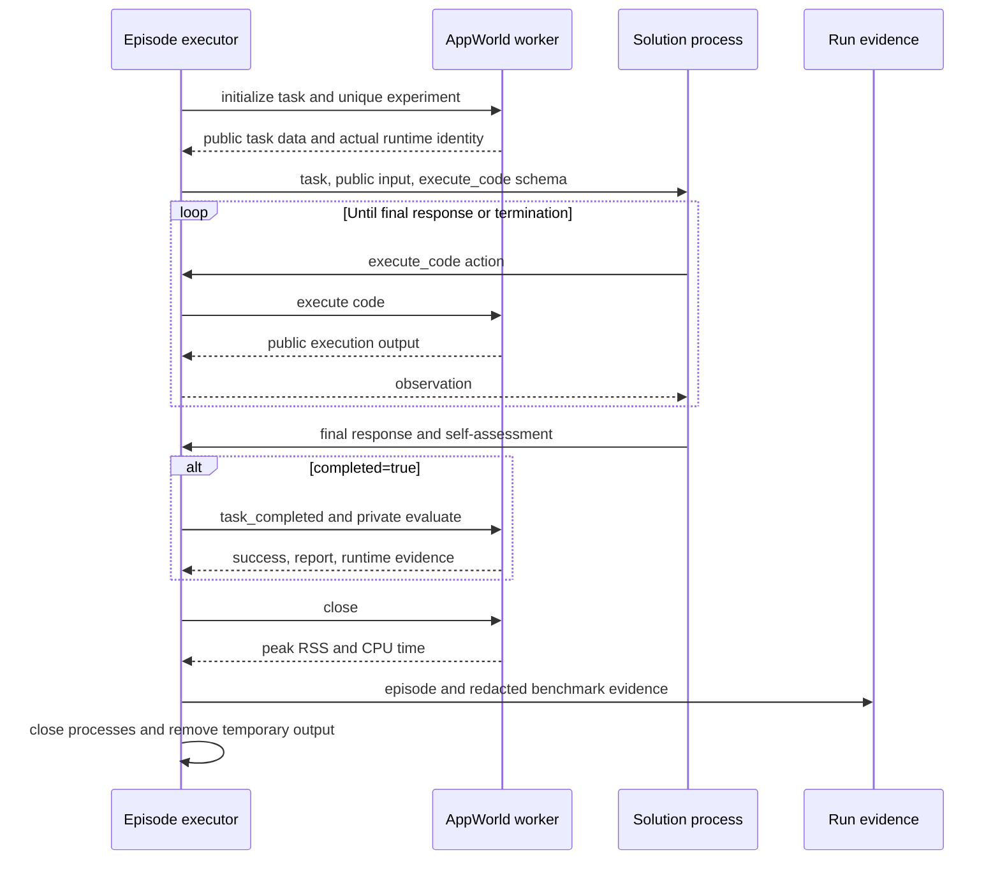

## AppWorld profile and benchmark adapter

### 1. Executive summary

#### 1.1 Spec description

The implementation will register an `appworld` full-validation profile for `reliable-agent-appworld` and add an AppWorld benchmark adapter behind a benchmark-neutral episode boundary. The profile will pin 315 tasks from AppWorld's train, dev, and test_normal splits, two repeats, and AC1, AC2, AC3, and AC7. An isolated, configurable stdio worker per episode will execute public agent code and perform private AppWorld evaluation, while existing partial-validation interfaces will support fine-grained diagnostic populations.

The investigation and its resource evidence are recorded in `.internal/investigations/appworld-profile.md`.

#### 1.2 Spec motivation

The `reliable-agent-appworld` constitution names `appworld` as its authoritative profile, but the service currently supports only PDDL Blocks World. AppWorld has different task loading, execution, scoring, dependency, isolation, and resource requirements. A registered profile and a real adapter are therefore necessary; a YAML file alone cannot validate the solution subproject.

#### 1.3 Implementation repos

https://github.com/anton-pershin/agent-validation — management and implementation repository.

### 2. Requirement analysis

This spec extends spec 12 FR1 by adding a third registered full-only profile. It retains spec 12's configuration-discovery, complete-partial, result-identity, provenance, and terminal-evidence contracts. No VM or AC formula is changed.

#### 2.1 Functional requirements

- **FR1. Registered `appworld` profile.** Pin `appworld==0.1.3.post1`, source commit `66ad8099e12188ece0d3fe45e661dbc01880813b`, data version `0.1.0`, the approved wheel/data hashes, and all 315 unique task IDs from train, dev, and test_normal. Use two repeats, no prompt variants or failure scenarios, and `solution_module = reliable_agent_appworld`. Enable AC1, AC2, AC3, and AC7 with Section 3 validation-spec defaults. Set `episode_concurrency = 1` as a configurable default. The resulting full population is 630 unperturbed episodes.
- **FR2. Benchmark-neutral execution.** Introduce a benchmark-session boundary for task presentation, tool descriptions, observations, action execution, scoring, and cleanup. Preserve Blocks World behavior and common VM/AC calculations. AppWorld task planning must not require PDDL files or expose benchmark-private data.
- **FR3. Reproducible isolated runtime.** Run AppWorld through a separate pre-provisioned Python environment configured by `AGENT_VALIDATION_APPWORLD_PYTHON` and `AGENT_VALIDATION_APPWORLD_ROOT`. Supply a version-locked dependency manifest and provisioning procedure that checks the approved package/data hashes. Record configured benchmark provenance in the run manifest and actual package/data versions in episode evidence.
- **FR4. Public AppWorld interaction.** Initialize one AppWorld world before task delivery and send only its public instruction, supervisor data, app descriptions, and the configured instructions. Expose an `execute_code` tool with a string `code` argument. Execute code in AppWorld's stateful shell with safety guards enabled. Return ordinary execution output and errors as observations. Support the existing transient-failure injection boundary without requiring an AppWorld failure scenario in the registered profile.
- **FR5. Independent completion and scoring.** Do not stop automatically when AppWorld reports task completion. After a valid final response, require the protocol completion declaration, AppWorld task completion, and `world.evaluate().success` for episode success. Do not evaluate or declare success when the protocol completion declaration is false. Keep evaluation results private to retained evidence. Missing/invalid self-assessment and solution failures retain their existing semantics.
- **FR6. Worker isolation and lifecycle.** Give each worker a unique experiment name and output location. Permit configured parallel workers through separate processes. Enforce the AppWorld interaction limit independently of disabled AC6, bound protocol output and execution time, terminate process trees on completion/failure/cancellation, remove temporary AppWorld output, and leave no persistent worker while idle.
- **FR7. Benchmark evidence and failure classification.** Retain AppWorld runtime identity, evaluation outcome/report, worker peak RSS, and worker CPU time in per-episode evidence. Treat initialization, execution-transport, evaluation, and cleanup failures that prevent observation/scoring as infrastructure failures. Do not convert them into unsuccessful solution episodes or send private errors to the solution.
- **FR8. Existing partial validation.** Expose the complete AppWorld configuration and JSON Schema through existing discovery. Accept complete modified copies with caller-selected task subsets, repeats, criteria, interaction limits, resources, and episode concurrency. Preserve base-profile identity and diagnostic-only semantics without adding a registered partial preset.
- **FR9. Specification and operations documentation.** Revise the validation spec, terminology, README, and solution interface for the new benchmark. Document package/data provisioning, full and partial invocation, configurable capacities, the measured no-op resource baseline, and optional host-level cgroup limits without fixing those limits in code.

#### 2.2 Non-functional requirements

- **NFR1. Frugality and configurability.** Default to one AppWorld worker and allocate no persistent benchmark process while idle. Keep episode concurrency, service-wide active/total episode capacities, interaction limits, and host resource controls configurable for other machines.
- **NFR2. Security and privacy.** Forward no provider credentials to the AppWorld worker. Never include ground truth, private evaluation outcomes, or evaluation reports in solution protocol messages. Redact retained worker output and evidence using existing service mechanisms.
- **NFR3. Reproducibility.** Bind full validation to explicit task IDs, code/data identities, dependency versions, resolved configuration, and runtime observations. A floating latest download is not sufficient.
- **NFR4. Failure containment.** Isolate worker state and resources per episode. A worker crash, timeout, stale world, output-path collision, or cleanup failure must not corrupt another episode or earlier run evidence.
- **NFR5. Compatibility and maintainability.** Keep benchmark-specific code outside common metrics and criteria. Retain existing API/CLI result shapes and Blocks World profile behavior. Use typed configuration and clear adapter responsibilities.

### 3. Acceptance criteria

- **AC1. Profile registration and population.** Tests must prove the exact package/data identities, 315 unique selected tasks with split counts 90/57/168, two repeats, 630 planned episodes, selected ACs and thresholds, solution module, unperturbed-only conditions, and configurable default concurrency one. Invalid benchmark-specific task/reference/configuration combinations must be rejected.
- **AC2. Discovery and partial configuration.** Tests must retrieve and resubmit the complete AppWorld configuration, reduce it to one task, modify repeats and worker/resource limits, and observe the correct planned population and unchanged registered hash. Missing/unknown fields and invalid references must fail before execution. Partial results must retain base identity and scope.
- **AC3. AppWorld protocol and scoring.** Worker tests must cover public task presentation, stateful `execute_code`, malformed/unknown actions, execution errors, transient injection, and no automatic completion stop. They must cover all combinations of protocol completion, AppWorld task completion, and evaluator success, and prove that private ground truth/evaluation data never appears in task or observation messages.
- **AC4. Isolation, limits, and cleanup.** Tests must run at least two workers concurrently with distinct output directories and no state mixing. They must prove that AppWorld can use its configured interaction limit independently of AC6, that timeouts/cancellation terminate workers, and that successful, failed, and aborted episodes leave no worker or temporary output. The PDDL AC6 limit must remain unchanged.
- **AC5. Evidence and infrastructure failures.** Tests must inspect retained package/data versions, evaluation result/report, peak RSS, and CPU time. Initialization, worker, evaluator, and cleanup failures must produce infrastructure episode records and invalid affected criteria rather than ordinary solution failures. Evidence must be redacted and terminal-run protection must remain effective.
- **AC6. Existing behavior.** The complete pre-existing test suite must pass without changing VM1–VM10, AC1–AC7 formulas, existing 840/890 populations, solution protocol semantics, API statuses, or run lifecycle behavior.
- **AC7. Real AppWorld smoke check.** Using the pinned provisioned runtime, one train task must initialize, execute a no-op code action, return a computed private evaluation, retain its evidence, release the worker, and clean temporary output. It must require no model provider and need not solve the task. CI must use a fake AppWorld package/worker and must not download the benchmark or run all 630 episodes.
- **AC8. Documentation and specification consistency.** The validation spec, terminology, README, solution interface, provisioning documentation, and this spec must agree on population, acceptance scope, commands, evidence, cleanup, and configurable resource settings. Ruff and the complete test suite must pass.

### 4. High-level solution design

The validation spec's layered design remains. The request/configuration, metric, criterion, and persistence contracts are retained. The benchmark adapter becomes a session factory with Blocks World and AppWorld implementations; AppWorld adds an isolated worker and benchmark evidence.

At component level, AppWorld setup occurs before the timed task message. Evaluation occurs after the final response and does not extend the measured solution response time.

The profile's `appworld.max_interactions` is a worker safety limit and is independent of `criteria.AC6.max_action_attempts`. The latter remains the PDDL action-budget threshold and is not selected by the registered AppWorld profile. The existing `resources.episode_concurrency` controls workers per validation, while existing service environment settings control total capacity across validations.
