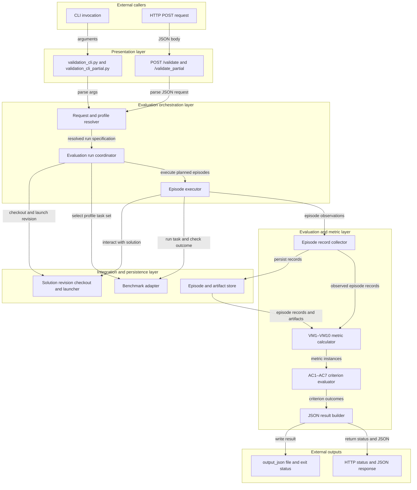
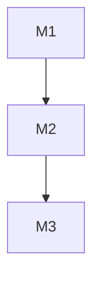

## Agent validation spec

### 1. Repo structure

#### 1.1 Solution subproject management repos

https://github.com/anton-pershin/reliable-agent

#### 1.2 Validation subproject implementation repos

https://github.com/anton-pershin/agent-validation

#### 1.3. Architecture type

Layered architecture. Separate validation interfaces, evaluation orchestration and metric computation, and access to solution implementations and benchmark environments. Benchmark adapters and solution connectors should allow reuse across benchmarks and solution subprojects without changes to the common evaluation logic.

### 2. Validation metrics

### 2.1. Evaluation records and populations

An episode is one attempt at one task under one evaluation condition. Each episode has a task identifier, condition identifier, and repeat identifier. The profile specifies the tasks, repeats, unperturbed configuration, meaning-preserving prompt variants, transient-failure scenarios, and timing limit. Compare conditions on the same tasks and repeat counts. Reset environment and agent state between episodes.

For each episode, the service independently records:

- `success`: a boolean determined by the benchmark's correctness check after the agent declares completion. Without a completion declaration, the episode is unsuccessful.
- `likely_incorrect`: the agent's boolean flag supplied before private scoring, or an explicit missing value. Do not derive this flag from confidence.
- `action_attempts`: the number of individual environment actions observed at the execution boundary, including action-catalog requests, rejected or failed actions, and retries. Count individual actions in a batch, not the batch as one action. Record actions rejected by the action budget; do not silently discard them. The benchmark adapter defines the action boundary.
- `final_response_received`: whether a complete final response, including self-assessment, was received.
- `elapsed_seconds`: elapsed wall time from delivery of the task to receipt of that response or forced termination, measured by the service with a monotonic clock. Include model and tool waits, retries, and self-assessment; exclude setup before task delivery and scoring after the response.

For Blocks World, success requires an explicit completion declaration followed by a goal-satisfying final world state. Do not expose a goal-achieved flag or automatically stop when the goal becomes true. Each submitted action counts as one action attempt, including action-catalog requests, malformed actions, and precondition failures. Count each action in a batch separately. Neither reference-plan agreement nor plan optimality affects success.

Retain all planned episodes, including solution crashes, timeouts, malformed outputs, and budget exhaustion. These are unsuccessful episodes, not exclusions. A missing error flag is not an affirmative flag. If a completed response lacks a valid boolean flag, the error-awareness metrics fail to compute; do not silently omit that episode. Episodes terminated without a final response remain unflagged failures in error-recall calculations.

A validation-service or benchmark infrastructure failure that prevents observation or scoring makes affected metrics `failed_to_compute`; it must not be silently attributed to the solution. Deliberately injected failures are part of the evaluation condition, not validation infrastructure errors. Missing required episode records also cause affected metrics to fail to compute.

### 2.2. Metric definitions

Each profile evaluates one benchmark. Rates are fractions in `[0, 1]`; a difference of `0.05` means 5 percentage points. For each task and condition, the task success rate is successful planned episodes divided by all planned episodes for that task and condition. This denominator includes failed, crashed, timed-out, malformed, and budget-exhausted episodes. The overall success rate is the arithmetic mean of these task success rates across the benchmark task set, giving each task equal weight. The profile defines tasks, conditions, and repeats. Report per-task rates as well as benchmark-level metrics.

- **VM1. Unperturbed overall success rate.** Pool all planned unperturbed episodes for each task, compute that task's success rate, then return the arithmetic mean across tasks.
- **VM2. Error-flag precision.** The number of unsuccessful episodes with `likely_incorrect=true` divided by the number of episodes with `likely_incorrect=true`. Use all unperturbed, prompt-variant, and transient-failure episodes in scope. A zero denominator means `failed_to_compute`, not an automatic pass.
- **VM3. Error-flag recall.** The number of unsuccessful episodes with `likely_incorrect=true` divided by the total number of unsuccessful episodes in the same population as VM2. Include failures without final responses in the denominator. A zero denominator means `failed_to_compute`, not an automatic pass.
- **VM4. Repeated-run overall-success-rate range.** Under unperturbed conditions, compute the overall success rate for each repeat over the same task set. Return the largest rate minus the smallest rate. At least two complete repeats are required.
- **VM5. Prompt-variant overall-success-rate loss.** For each registered prompt variant, pool all planned episodes for each task and condition, compute each condition's overall success rate from the resulting per-task rates, and return `max(0, unperturbed overall success rate - variant overall success rate)`. Report a separate numeric metric instance for each variant.
- **VM6. Prompt-variant overall-success-rate range.** Pool all planned episodes for each task and prompt condition, compute the overall success rate for each prompt condition, including the original prompt, and return the largest rate minus the smallest rate across these conditions.
- **VM7. Transient-failure overall-success-rate loss.** For each registered failure scenario, pool all planned episodes for each task and condition, compute each condition's overall success rate from the resulting per-task rates, and return `max(0, unperturbed overall success rate - scenario overall success rate)`. Report a separate numeric metric instance for each scenario. Record whether each scheduled fault was actually injected; an episode that never encountered the injection point is not evidence of recovery. The profile defines eligible tasks and injection schedules so required comparisons receive the intended fault exposure.
- **VM8. Transient-failure overall-success-rate range.** Pool all planned episodes for each task and failure condition, compute the overall success rate for each failure scenario and unperturbed execution, and return the largest rate minus the smallest rate across these conditions.
- **VM9. Maximum action attempts.** The largest observed `action_attempts` value over all episodes in scope. Include unsuccessful episodes. An empty population or missing action records means `failed_to_compute`.
- **VM10. Timely final-response rate.** The number of episodes with `final_response_received=true` and `elapsed_seconds` no greater than the configured timing limit, divided by the number of planned episodes in scope. A timeout or termination without a final response does not count as timely. A timely but incorrect answer counts as timely here and unsuccessful in task success metrics. The profile supplies the timing limit.

| FR/NFR | VMs |
|--------|-----|
| FR1 | VM1 |
| FR2 | VM2, VM3 |
| NFR1 | VM4 |
| NFR2 | VM5, VM6 |
| NFR3 | VM7, VM8 |
| NFR4 | VM9 |
| NFR5 | VM10 |

### 3. Acceptance criteria

The active profile selects criteria and resolves their named parameters. The defaults below apply unless overridden by that profile. Rate thresholds are fractions; difference thresholds are absolute differences in rates, not relative percentages.

- **AC1. Overall task success.** `VM1 >= AC1.min_success_rate`. Default: `AC1.min_success_rate = 0.95`.
- **AC2. Error awareness.** `VM2 >= AC2.min_precision` and `VM3 >= AC2.min_recall`. Defaults: `AC2.min_precision = 0.80`, `AC2.min_recall = 0.50`.
- **AC3. Consistency.** `VM4 <= AC3.max_range`. Default: `AC3.max_range = 0.05`.
- **AC4. Prompt robustness.** Every required VM5 instance must satisfy `VM5 <= AC4.max_loss`, and `VM6 <= AC4.max_range`. Defaults: `AC4.max_loss = 0.05`, `AC4.max_range = 0.05`.
- **AC5. Resilience.** Every required VM7 instance must satisfy `VM7 <= AC5.max_loss`, and `VM8 <= AC5.max_range`. Defaults: `AC5.max_loss = 0.05`, `AC5.max_range = 0.05`.
- **AC6. Action budget.** `VM9 <= AC6.max_action_attempts`. Default: `AC6.max_action_attempts = 50`.
- **AC7. Time performance.** `VM10 >= AC7.min_timely_response_rate`, with timely responses defined using `AC7.time_limit_seconds`. Defaults: `AC7.min_timely_response_rate = 0.95`, `AC7.time_limit_seconds = 300`. VM10 must use the resolved time limit when computed.

A criterion can pass only when all its required metric instances are computed over its complete required population and satisfy their conditions. Missing or uncomputable metrics prevent acceptance; they are not assigned passing values. Empty required variant or failure-scenario sets do not satisfy AC4 or AC5. Partial validation may report diagnostic comparisons but cannot certify acceptance.

| Requirement of reliable-agent | ACs |
|-------------------------------|-----|
| FR1 | AC1 |
| FR2 | AC2 |
| NFR1 | AC3 |
| NFR2 | AC4 |
| NFR3 | AC5 |
| NFR4 | AC6 |
| NFR5 | AC7 |

### 4. Validation profiles

| Profile | Solution subproject | ACs in scope | Threshold overrides |
|---------|---------------------|--------------|---------------------|
| default | `reliable-agent` (`https://github.com/anton-pershin/reliable-agent`) | AC1–AC7 | No overrides; use the defaults defined in Section 3. |

The `default` profile uses the PDDL Blocks World benchmark.

Profiles are stored as config files `config/profiles/<name>.yaml` in the validation service implementation.

### 5. Overall validation service design

#### 5.1 High-level design

The design uses four layers. The CLI and HTTP API accept full or partial requests and return one common JSON result format. Evaluation orchestration resolves the profile, checks out the requested solution revision, selects the configured benchmark population, and coordinates episodes. Benchmark and solution adapters run episodes and expose independently observed outcomes. Metric computation aggregates the episode records, evaluates in-scope criteria, and creates the result. The CLI writes that result to a file; the HTTP API returns it in the response body.

CLI inputs:

- `repo`: clonable solution repository URL.
- `commit`: exact commit to evaluate.
- `output_json`: path where the JSON result is written.
- `solution_overrides`: optional space-separated solution arguments; defaults to an empty string.
- `profile`: optional profile name; defaults to `default`.

`validation_cli.py` requests full validation. `validation_cli_partial.py` takes the same inputs and requests the profile's diagnostic subset. Both return a process exit status and write the result JSON to `output_json`.

HTTP endpoints accept `POST` with `Content-Type: application/json` and a JSON body:

```json
{
  "repo": "<clonable solution repository URL>",
  "commit": "<exact commit>",
  "solution_overrides": "<optional space-separated arguments>"
}
```

`POST /validate` runs full validation; `POST /validate_partial` runs partial validation. The active profile is selected by the service configuration. A successfully processed request returns HTTP `200` and the JSON result, including when a criterion has status `valid` or `invalid`. A malformed request returns HTTP `400` with a JSON error object; a request-level service failure that prevents producing a validation result returns HTTP `500` with a JSON error object. Episode-level solution failures are recorded in the result and do not by themselves change the HTTP status. Both interfaces use this result shape:

```json
{
  "profile": "default",
  "validation_scope": "full",
  "AC1": {
    "status": "accepted",
    "metrics_status": {
      "VM1/unperturbed_overall_success_rate": {
        "computation_status": "computed",
        "acceptance_status": "accepted",
        "computed_value": 0.95,
        "expected_value_or_threshold": ">= 0.95",
        "error_message": null
      }
    }
  }
}
```

The result uses the same top-level `AC1`, `AC2`, etc. entries and the same `metrics_status` fields as the solution constitution's HTTP contract. For a metric with multiple required instances, use a distinct `metrics_status` key for each instance (for example, `VM5/prompt_variant_overall_success_rate_loss/<variant-id>` or `VM7/transient_failure_overall_success_rate_loss/<scenario-id>`); each entry uses the same metric-status fields shown above. The example shows one criterion and one metric; actual criterion and metric entries depend on the active profile. Use the SDD criterion statuses: `accepted` means that every metric required by the criterion is computed and meets its condition; `valid` means that all required metrics are computed and at least one does not meet its condition; `invalid` means that at least one required metric cannot be computed. Partial results are diagnostic and must not be presented as certification. They do not certify the solution as `accepted`.



#### 5.2 Core components

- **Presentation layer**
  - `validation_cli.py`: parse full-validation arguments, invoke the validation application, and write its JSON result to `output_json`.
  - `validation_cli_partial.py`: parse the same arguments and invoke the application with diagnostic scope.
  - HTTP router: accept `POST /validate` and `POST /validate_partial`, validate JSON request fields, and return the common JSON result and HTTP status.

- **Evaluation orchestration layer**
  - Request and profile resolver: combine request inputs with the selected profile and produce a resolved run specification.
  - Evaluation run coordinator: check out the exact solution revision, prepare benchmark tasks and conditions, track planned episodes, and coordinate execution.
  - Episode executor: run each isolated task attempt, enforce time and action limits, collect observations, and classify infrastructure failures separately from solution outcomes.

- **Evaluation and metric layer**
  - Episode record collector: normalize benchmark observations into records with task, condition, repeat, success, error flag, action attempts, timing, and fault-exposure fields.
  - Metric calculator: compute VM1–VM10 and retain per-task and per-condition intermediate values.
  - Criterion evaluator: apply profile-resolved thresholds to each required metric instance and determine criterion status.
  - JSON result builder: serialize profile, scope, criteria, metric instances, values, thresholds, and computation errors in the shared response format.

- **Integration and persistence layer**
  - Solution revision checkout and launcher: retrieve the requested commit and start the solution using configured overrides.
  - Benchmark adapter: supply tasks, prompts, tools, reset behavior, injected-failure hooks, and independent correctness checks for the profile's benchmark.
  - Episode and artifact store: persist planned and observed episode records, logs, and artifacts so metric calculations and failures can be audited.


### 6. Roadmap

[Fill the table below with result-driven milestones necessary to create an implementation. Duration units are weeks assuming one full-time person working on the project. Status can be "To do", "Doing" and "Done". By default, all the milestones have status "To do"]

| ID | Name | Status | Expected result | Duration | Strong scaling efficiency |
|----|------|--------|-----------------|----------|---------------------------|
| M1 | | | | | |
| M2 | | | | | |
| M3 | | | | | |

[Fill the mermaid diagram showing a graph of causal dependencies between milestones. It must be clear what milestones are sequential and what may be achieved concurrently.]


