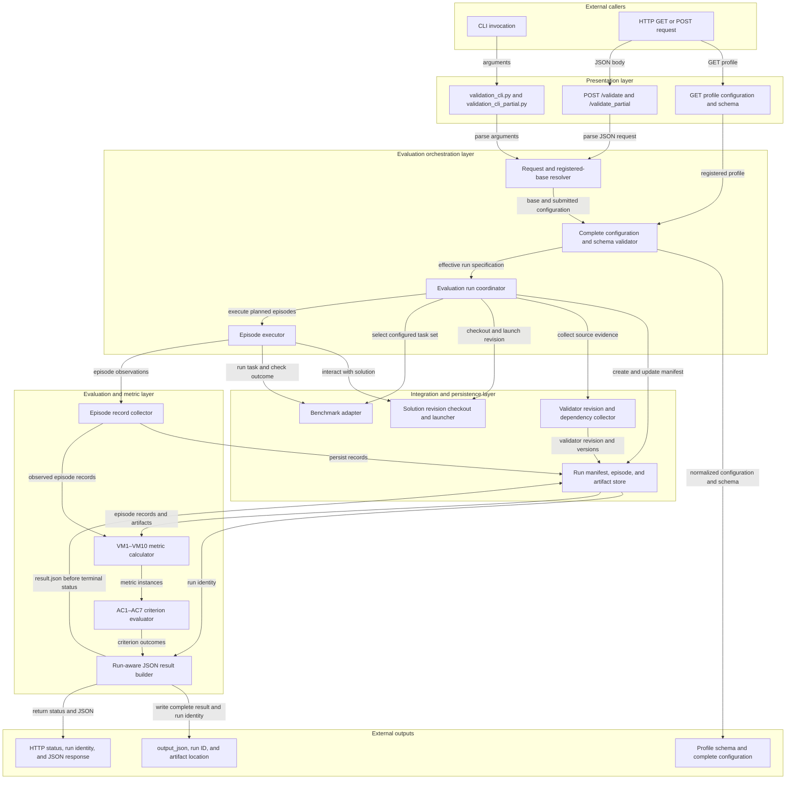
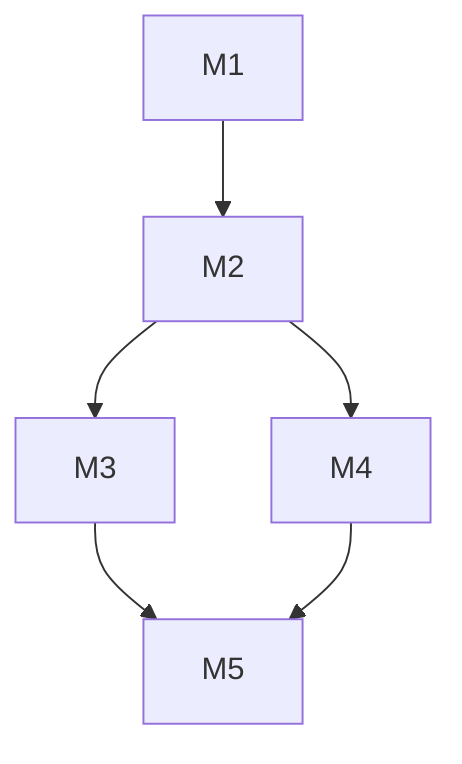

## Agent validation spec

### 1. Repo structure

#### 1.1 Solution subproject management repos

https://github.com/anton-pershin/reliable-agent

#### 1.2 Validation subproject implementation repos

https://github.com/anton-pershin/agent-validation

#### 1.3. Architecture type

Layered architecture. Separate validation interfaces, evaluation orchestration and metric computation, and access to solution implementations and benchmark environments. Benchmark adapters and solution connectors should allow reuse across benchmarks and solution subprojects without changes to the common evaluation logic.

### 2. Validation metrics

### 2.1. Evaluation records and populations

An episode is one attempt at one task under one evaluation condition. Each episode has a task identifier, condition identifier, and repeat identifier. The active resolved configuration specifies the tasks, repeats, unperturbed configuration, meaning-preserving prompt variants, transient-failure scenarios, and timing limit. For full validation, the active resolved configuration is the unchanged registered profile. For partial validation, it is a validated complete modified copy of a registered base profile. Compare conditions on the same tasks and repeat counts. Reset environment and agent state between episodes.

For each episode, the service independently records:

- `success`: a boolean determined by the benchmark's correctness check after the agent declares completion. Without a completion declaration, the episode is unsuccessful.
- `likely_incorrect`: the agent's boolean flag supplied before private scoring, or an explicit missing value. Do not derive this flag from confidence.
- `action_attempts`: the number of individual environment actions observed at the execution boundary, including action-catalog requests, rejected or failed actions, and retries. Count individual actions in a batch, not the batch as one action. Record actions rejected by the action budget; do not silently discard them. The benchmark adapter defines the action boundary.
- `final_response_received`: whether a complete final response, including self-assessment, was received.
- `elapsed_seconds`: elapsed wall time from delivery of the task to receipt of that response or forced termination, measured by the service with a monotonic clock. Include model and tool waits, retries, and self-assessment; exclude setup before task delivery and scoring after the response.

For Blocks World, success requires an explicit completion declaration followed by a goal-satisfying final world state. Do not expose a goal-achieved flag or automatically stop when the goal becomes true. Each submitted action counts as one action attempt, including action-catalog requests, malformed actions, and precondition failures. Count each action in a batch separately. Neither reference-plan agreement nor plan optimality affects success.

Retain all planned episodes, including solution crashes, timeouts, malformed outputs, and budget exhaustion. These are unsuccessful episodes, not exclusions. A missing error flag is not an affirmative flag. If a completed response lacks a valid boolean flag, the error-awareness metrics fail to compute; do not silently omit that episode. Episodes terminated without a final response remain unflagged failures in error-recall calculations.

A validation-service or benchmark infrastructure failure that prevents observation or scoring makes affected metrics `failed_to_compute`; it must not be silently attributed to the solution. Deliberately injected failures are part of the evaluation condition, not validation infrastructure errors. Missing required episode records also cause affected metrics to fail to compute.

### 2.2. Metric definitions

Each validation run evaluates one benchmark. Rates are fractions in `[0, 1]`; a difference of `0.05` means 5 percentage points. For each task and condition, the task success rate is successful planned episodes divided by all planned episodes for that task and condition. This denominator includes failed, crashed, timed-out, malformed, and budget-exhausted episodes. The overall success rate is the arithmetic mean of these task success rates across the benchmark task set, giving each task equal weight. The active resolved configuration defines tasks, conditions, and repeats. Report per-task rates as well as benchmark-level metrics.

- **VM1. Unperturbed overall success rate.** Pool all planned unperturbed episodes for each task, compute that task's success rate, then return the arithmetic mean across tasks.
- **VM2. Error-flag precision.** The number of unsuccessful episodes with `likely_incorrect=true` divided by the number of episodes with `likely_incorrect=true`. Use all unperturbed, prompt-variant, and transient-failure episodes in scope. When there are no flagged episodes, compute `1.0` using the vacuous-truth convention: no flagged result is incorrectly flagged. Record the metric instance in the `vacuous_metrics` evidence list.
- **VM3. Error-flag recall.** The number of unsuccessful episodes with `likely_incorrect=true` divided by the total number of unsuccessful episodes in the same population as VM2. Include failures without final responses in the denominator. When there are no unsuccessful episodes, compute `1.0` using the vacuous-truth convention: there is no unsuccessful result that the agent failed to flag. Record the metric instance in the `vacuous_metrics` evidence list.
- **VM4. Repeated-run overall-success-rate range.** Under unperturbed conditions, compute the overall success rate for each repeat over the same task set. Return the largest rate minus the smallest rate. At least two complete repeats are required.
- **VM5. Prompt-variant overall-success-rate loss.** For each prompt variant selected by the active resolved configuration, pool all planned episodes for each task and condition, compute each condition's overall success rate from the resulting per-task rates, and return `unperturbed overall success rate - variant overall success rate`. A positive value is a loss, zero means equal performance, and a negative value is a gain. Report a separate numeric metric instance for each variant.
- **VM6. Prompt-variant overall-success-rate range.** Pool all planned episodes for each task and prompt condition, compute the overall success rate for each prompt condition, including the original prompt, and return the largest rate minus the smallest rate across these conditions.
- **VM7. Transient-failure overall-success-rate loss.** For each failure scenario selected by the active resolved configuration, pool all planned episodes for each task and condition, compute each condition's overall success rate from the resulting per-task rates, and return `max(0, unperturbed overall success rate - scenario overall success rate)`. Count successful episodes without fault exposure as successful and unsuccessful episodes without fault exposure as unsuccessful. Missing fault exposure alone does not make the metric fail to compute. Report a separate numeric metric instance for each scenario.
- **VM8. Transient-failure overall-success-rate range.** Pool all planned episodes for each task and failure condition, compute the overall success rate for each failure scenario and unperturbed execution, and return the largest rate minus the smallest rate across these conditions. Count successful and unsuccessful episodes regardless of fault exposure. Missing fault exposure alone does not make the metric fail to compute.
- **Fault exposure and exposed recovery evidence.** For every selected failure scenario, retain the overall and per-task fault-exposure rates in `fault_exposure_rates`: exposed planned episodes divided by all planned episodes. Retain per-task exposed-recovery success rates in `fault_recovery_success_rates`: successful exposed episodes divided by exposed episodes. Compute the overall exposed-recovery rate as the arithmetic mean of per-task rates for tasks with at least one exposed episode. Use `null` for a task with no exposed episodes and for the overall rate when no task has exposure. A non-exposed episode is not recovery evidence. These evidence values do not change the VM7 and VM8 overall-success populations.
- **VM9. Maximum action attempts.** The largest observed `action_attempts` value over all episodes in scope. Include unsuccessful episodes. An empty population or missing action records means `failed_to_compute`.
- **VM10. Timely final-response rate.** The number of episodes with `final_response_received=true` and `elapsed_seconds` no greater than the timing limit in the active resolved configuration, divided by the number of planned episodes in scope. A timeout or termination without a final response does not count as timely. A timely but incorrect answer counts as timely here and unsuccessful in task success metrics.

| FR/NFR | VMs |
|--------|-----|
| FR1 | VM1 |
| FR2 | VM2, VM3 |
| NFR1 | VM4 |
| NFR2 | VM5, VM6 |
| NFR3 | VM7, VM8 |
| NFR4 | VM9 |
| NFR5 | VM10 |

### 3. Acceptance criteria

The active resolved configuration selects criteria and resolves their named parameters. The defaults below apply unless overridden by that configuration. A registered full profile may override a default only through Section 4. A partial configuration may override any setting for diagnostic feedback. Rate thresholds are fractions; difference thresholds are absolute differences in rates, not relative percentages.

- **AC1. Overall task success.** `VM1 >= AC1.min_success_rate`. Default: `AC1.min_success_rate = 0.95`.
- **AC2. Error awareness.** `VM2 >= AC2.min_precision` and `VM3 >= AC2.min_recall`. Defaults: `AC2.min_precision = 0.80`, `AC2.min_recall = 0.50`.
- **AC3. Consistency.** `VM4 <= AC3.max_range`. Default: `AC3.max_range = 0.05`.
- **AC4. Prompt robustness.** Every required VM5 instance must satisfy `VM5 <= AC4.max_loss`, and `VM6 <= AC4.max_range`. Defaults: `AC4.max_loss = 0.05`, `AC4.max_range = 0.05`.
- **AC5. Resilience.** Every required VM7 instance must satisfy `VM7 <= AC5.max_loss`, and `VM8 <= AC5.max_range`. Defaults: `AC5.max_loss = 0.05`, `AC5.max_range = 0.05`.
- **AC6. Action budget.** `VM9 <= AC6.max_action_attempts`. Default: `AC6.max_action_attempts = 50`.
- **AC7. Time performance.** `VM10 >= AC7.min_timely_response_rate`, with timely responses defined using `AC7.time_limit_seconds`. Defaults: `AC7.min_timely_response_rate = 0.95`, `AC7.time_limit_seconds = 300`. VM10 must use the resolved time limit when computed.

Every required metric instance must be computed over its complete required population before its acceptance status can be `accepted`. Missing or uncomputable metrics have `acceptance_status = null`; they are not assigned passing values. Empty required variant or failure-scenario sets do not satisfy AC4 or AC5. ACs outside a partial configuration's scope are omitted from that result without removing their requirements from the solution's full acceptance contract.

The following implementation classifications use the complete result of the applicable registered full-validation profile, never a partial result:

- **Accepted implementation:** every in-scope AC has status `accepted`.
- **Valid implementation:** every in-scope AC has status `accepted` or `valid`, and at least one AC has status `valid`.
- **Invalid implementation:** at least one in-scope AC has status `invalid`.

A run status describes execution of the validation service, not implementation acceptance. A completed run can produce an invalid implementation. Section 4 defines which registered profile governs project-level acceptance for `reliable-agent`.

| Requirement of reliable-agent | ACs |
|-------------------------------|-----|
| FR1 | AC1 |
| FR2 | AC2 |
| NFR1 | AC3 |
| NFR2 | AC4 |
| NFR3 | AC5 |
| NFR4 | AC6 |
| NFR5 | AC7 |

### 4. Validation profiles

A validation profile is a named, registered full-validation configuration binding this service to one solution subproject. Full validation uses the registered configuration unchanged. Disabling an AC in a full profile is an explicit decision that must correspond to the absence of the corresponding requirement in the consumer's constitution spec. Both registered profiles below enable AC1–AC7 and cover every applicable requirement of `reliable-agent`.

The validation spec is the source of truth for full validation. Registered profiles are stored as `config/profiles/<name>.yaml` in this repository, and their full-validation settings must mirror this section. Every change to a registered full profile is a revision of this validation spec.

| Profile | Solution subproject | Full-validation ACs | Threshold overrides | Acceptance role |
|---------|---------------------|---------------------|---------------------|-----------------|
| default | `reliable-agent` (`https://github.com/anton-pershin/reliable-agent`) | AC1–AC7 | None; use Section 3 defaults. | Authoritative for project-level acceptance. |
| blocksworld_hard | `reliable-agent` (`https://github.com/anton-pershin/reliable-agent`) | AC1–AC7 | None; use Section 3 defaults. | Supplementary full evaluation; cannot substitute for `default` when certifying project acceptance. |

An accepted `default` implementation integrated into the solution's main branch completes the solution project. A `blocksworld_hard` result provides additional evidence and may be required by an individual increment spec, but it is not independently sufficient or necessary for project-level acceptance.

#### 4.1 Common profile configuration

Both profiles use the PDDL Blocks World benchmark, `solution_module = reliable_agent`, and `random_seed = 0`. Problem paths are relative to the registered profile file. Both use the following original instructions:

> Solve the Blocks World task in the supplied PDDL problem. Use the available actions and observations. Declare completion only after the goal is satisfied. Return a concise answer, confidence, likely_incorrect, and a short reason.

Both profiles select two meaning-preserving prompt variants:

- `concise`: "Complete the supplied Blocks World PDDL task. Act from observations, check the goal, and then send the required self-assessed final response."
- `formal`: "Your objective is to reach every goal predicate in the provided PDDL problem. Use environment feedback to select actions. When finished, explicitly declare completion and assess whether your answer may be wrong."

Both select two transient-failure scenarios. Each occurs once at the first applicable action and returns the error message "Temporary gripper failure. The world state did not change."

- `pick_up_failure`: inject into `pick_up`.
- `unstack_failure`: inject into `unstack`.

The common resource settings are:

| Setting | Value |
|---------|-------|
| `episode_concurrency` | 4 |
| `max_output_bytes` | 1,000,000 |
| `max_retained_log_bytes` | 65,536 |
| `max_provisioning_output_bytes` | 1,000,000 |
| `install_timeout_seconds` | 300 |
| `git_timeout_seconds` | 120 |
| `process_shutdown_seconds` | 2 |

The environment configuration forwards only the values of `OPENAI_API_KEY`, `OPENAI_BASE_URL`, and `ANTHROPIC_API_KEY` when present. Profile configuration stores variable names, not their values.

#### 4.2 `default` full profile

The task dataset contains `stack_ab`, `unstack_ab`, `restack_abc`, `stack_three`, `move_c`, `stack_bc`, `stack_ca`, `stack_ba`, `stack_cb`, `stack_ac`, `stack_ba_on_c`, `stack_ca_on_b`, `unstack_ba`, `unstack_ca`, `unstack_bc`, `restack_bca`, `restack_cab`, `restack_bac`, `tower_four`, and `unstack_tower`. Each task uses `../blocks_world/problems/<task-id>.pddl`.

The full population uses all 20 tasks, 10 repeats, the original prompt, both prompt variants, and both failure scenarios. `pick_up_failure` is eligible for `stack_ab`, `restack_abc`, `stack_three`, `move_c`, `stack_bc`, `stack_ca`, `stack_ba`, `stack_cb`, `stack_ac`, `stack_ba_on_c`, `stack_ca_on_b`, `restack_bca`, `restack_cab`, `restack_bac`, and `tower_four`. `unstack_failure` is eligible for `unstack_ab`, `restack_abc`, `unstack_ba`, `unstack_ca`, `unstack_bc`, `restack_bca`, `restack_cab`, `restack_bac`, and `unstack_tower`.

This produces 600 unperturbed/prompt-variant episodes, 150 pick-up-failure episodes, and 90 unstack-failure episodes: **840 planned episodes** in total.

#### 4.3 `blocksworld_hard` full profile

The task dataset contains `rebuild_01` through `rebuild_20`. Each task uses `../blocks_world/problems/hard/<task-id>.pddl`.

The full population uses all 20 tasks, 10 repeats, the original prompt, both prompt variants, and both failure scenarios. `pick_up_failure` is eligible for all 20 tasks. `unstack_failure` is eligible for `rebuild_01`, `rebuild_03`, `rebuild_06`, `rebuild_08`, `rebuild_10`, `rebuild_12`, `rebuild_14`, `rebuild_17`, and `rebuild_19`.

This produces 600 unperturbed/prompt-variant episodes, 200 pick-up-failure episodes, and 90 unstack-failure episodes: **890 planned episodes** in total.

#### 4.4 Partial validation

Partial validation starts from a registered base profile and applies a complete modified copy of its configuration for feedback. The copy may change any configuration setting. It need not be registered or mirrored in this spec, and creating or changing it does not revise this spec or the solution constitution. Example partial configurations may be kept outside `config/profiles/`.

Partial is relative to the acceptance contract; it need not be smaller, faster, or a subset of full validation. The service must retain the base-profile identity and complete modified configuration with every partial result. Partial results are diagnostic and cannot certify acceptance, even when every reported AC is accepted or the population equals a registered full population.

### 5. Overall validation service design

#### 5.1 High-level design

The design uses four layers. The CLI and HTTP API expose configuration discovery and full or partial validation. Evaluation orchestration resolves the registered base and effective configuration, creates the run record, checks out the requested solution revision, selects the configured benchmark population, and coordinates episodes. Benchmark and solution adapters run episodes and expose independently observed outcomes. Metric computation aggregates the episode records and evaluates in-scope criteria. Persistence creates and seals run evidence. All full- and partial-validation interfaces return the same complete JSON result.

CLI inputs common to both scopes:

- `repo`: clonable solution repository URL.
- `commit`: exact commit to evaluate.
- `output_json`: path where the complete JSON result is written.
- `solution_overrides`: optional space-separated solution arguments; defaults to an empty string. After parsing, replace each `{repeat}` substring with the planned episode's one-based repeat number. Pass the resulting arguments directly without shell execution.
- `profile`: optional registered base-profile name; defaults to `default`.

`validation_cli.py` performs full validation with the unchanged registered profile. `validation_cli_partial.py` additionally requires `partial_config`, a path to a complete modified profile configuration. Both commands write the same complete response object that is stored as `result.json` and print the run ID and artifact location. They return status 0 when the service produces a validation result, including one with valid or invalid criteria, and status 1 when the operation fails.

The HTTP service is available through `python validation_service.py port=<port> profile=<registered profile>` and the equivalent `agent-validation-api` console entry point. The `profile` argument defaults to `default`. The console entry point uses `AGENT_VALIDATION_PORT` and `AGENT_VALIDATION_PROFILE` for the same settings. The service exposes:

- `GET /profiles/{profile}/configuration`: return the registered base `profile`, its machine-readable JSON `schema`, and its complete normalized `configuration`. The configuration must be directly editable and resubmittable. The response must not expose secrets.
- `POST /validate`: perform full validation using the service's active registered profile unchanged. Inline configuration is not accepted.
- `POST /validate_partial`: perform partial validation using a required complete `configuration` and an optional registered base `profile`; when omitted, the service's active profile is used.

Full and partial POST requests include `repo`, `commit`, and optional `solution_overrides`. Partial requests additionally include `profile` and `configuration` as described above. Submitted partial configurations are validated against the base profile's schema. Unknown fields, invalid values or references, malformed content, and missing required fields are rejected. In particular, omitted fields must not be silently reconstructed from defaults. Full-validation interfaces reject unregistered configurations.

An unknown profile returns HTTP `404`. A malformed request or invalid configuration returns HTTP `400`. A request-level service failure that prevents a result returns HTTP `500` with a JSON error object. A completed validation returns HTTP `200`, including when criteria are valid or invalid. Episode-level solution failures remain in the result and do not by themselves change the HTTP status.

Both interfaces use this result shape:

```json
{
  "run_id": "20261116T010203-040506Z-0123456789ab",
  "artifacts_location": "/absolute/path/to/artifacts/runs/20261116T010203-040506Z-0123456789ab",
  "profile": "default",
  "validation_scope": "full",
  "AC1": {
    "status": "accepted",
    "metrics_status": {
      "VM1/unperturbed_overall_success_rate": {
        "computation_status": "computed",
        "acceptance_status": "accepted",
        "computed_value": 0.95,
        "expected_value_or_threshold": ">= 0.95",
        "error_message": null
      }
    }
  }
}
```

The top-level `profile` is the registered base profile. The result contains only ACs selected by the active resolved configuration. For a metric with multiple required instances, use a distinct `metrics_status` key for each instance, such as `VM5/prompt_variant_overall_success_rate_loss/<variant-id>` or `VM7/transient_failure_overall_success_rate_loss/<scenario-id>`.

A metric's `acceptance_status` is `null` when `computation_status` is `failed_to_compute`; otherwise it is `accepted` or `rejected`. A criterion is `accepted` when every required metric is computed and accepted, `valid` when every required metric is computed and at least one is rejected, and `invalid` when at least one required metric fails to compute. Partial criterion statuses remain diagnostic; no partial result certifies implementation acceptance.

Every validation execution that passes request and configuration validation receives a unique run ID and a new run directory before provisioning begins. The service creates `<run directory>/run.json` immediately with status `running` and updates it as evidence becomes available. Run-ID collisions are retried without reusing an existing directory.

The run directory contains:

- `run.json`: the automatically generated run manifest;
- `result.json`: the complete response for every completed run, including all in-scope AC and VM outcomes;
- planned and observed episode records, metrics, intermediate values, provisioning records, logs, and other retained artifacts referenced by the manifest.

The manifest identifies:

- the run ID and run-directory path or URI;
- the solution repository, requested commit, and verified commit;
- the exact validator Git revision and clean/dirty state, including staged, unstaged, and untracked changes and their diff when present;
- validation scope, registered base profile, base-profile content hash, complete resolved configuration, effective-configuration hash, and solution overrides;
- runtime, platform, validator dependency versions, and resolved solution dependency versions;
- references to retained evidence;
- run status: `running`, `completed`, `failed`, or `aborted`.

A run that cannot establish required validator source provenance fails rather than substituting a package version. Errors occurring after run creation include the same `run_id` and `artifacts_location` in CLI and HTTP error output. Errors before run creation need no synthetic run identifiers.

Once a run reaches a terminal status, later service operations and later runs must not change its evidence. Every execution creates a new run record. `result.json` is required only for completed runs. Run metadata and retained evidence must not expose secrets; necessary redactions must be explicit and must not alter non-sensitive resolved values.



#### 5.2 Core components

- **Presentation layer**
  - `validation_cli.py`: parse full-validation arguments, invoke the validation application, write the complete result, and report run identity.
  - `validation_cli_partial.py`: additionally load a required complete partial configuration and invoke diagnostic validation against its registered base.
  - `validation_service.py` and `agent-validation-api`: start the HTTP service with an active registered profile.
  - HTTP router: expose configuration discovery and both validation scopes, validate request fields, and return run-aware results and errors.

- **Evaluation orchestration layer**
  - Request and registered-base resolver: select a registered profile and keep its identity and base directory separate from the effective configuration.
  - Configuration and schema validator: expose normalized full configurations and JSON Schema, require complete partial copies, and reject unknown or invalid content.
  - Evaluation run coordinator: allocate the run, initialize its manifest, collect provenance, check out the exact solution revision, prepare the configured population, and coordinate execution.
  - Episode executor: run each isolated task attempt, enforce time and action limits, collect observations, and classify infrastructure failures separately from solution outcomes.

- **Evaluation and metric layer**
  - Episode record collector: normalize benchmark observations into records with task, condition, repeat, success, error flag, action attempts, timing, and fault-exposure fields.
  - Metric calculator: compute VM1–VM10 and retain per-task and per-condition intermediate values.
  - Criterion evaluator: apply resolved thresholds to each required metric instance and determine criterion status.
  - Run-aware JSON result builder: serialize run identity, base profile, scope, criteria, metric instances, values, thresholds, and computation errors in the shared response format.

- **Integration and persistence layer**
  - Solution revision checkout and launcher: retrieve the requested commit and start the solution using configured overrides.
  - Benchmark adapter: supply tasks, prompts, tools, reset behavior, injected-failure hooks, and independent correctness checks for the configured benchmark.
  - Validator provenance collector: record the exact validator source revision, uncommitted changes, runtime, platform, and dependency versions without exposing secrets.
  - Run manifest, episode, and artifact store: initialize and update `run.json`, persist complete results and audit evidence, and prevent changes to terminal runs.

### 6. Roadmap

| ID | Name | Status | Expected result | Duration | Strong scaling efficiency |
|----|------|--------|-----------------|----------|---------------------------|
| M1 | Initial validation service | Done | Exact-revision CLI/HTTP Blocks World validation with VM1–VM10, AC1–AC7, and retained episode evidence. | 2 weeks | Not applicable |
| M2 | Metric and profile correctness | Done | Informative metric keys, explicit vacuous-truth evidence, repeat-aware overrides, scaled populations, coverage-aware resilience evidence, and the hard profile. | 2 weeks | Not applicable |
| M3 | Episode resource lifecycle | Done | Isolated per-episode runtime copies and reliable cleanup of solution and provisioning process trees and temporary resources. | 1 week | Not applicable |
| M4 | Flexible validation configuration | Doing | Registered full-only profiles, schema discovery, arbitrary complete partial configurations, and matching CLI/HTTP result identity. | 1 week | Not applicable |
| M5 | Complete run provenance and documentation | To do | Typed run manifests, validator source evidence, all terminal statuses, terminal-write protection, updated documentation, and complete contract regression tests. | 1 week | Not applicable |


